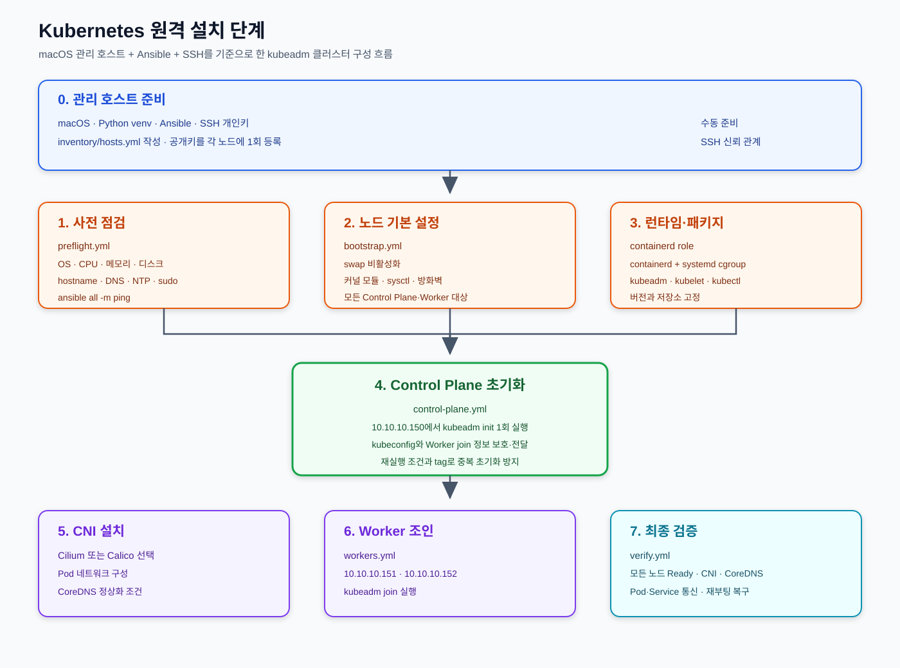

# Kubernetes 원격 설치 계획

이 문서는 원격 서버에 Kubernetes를 설치하기 위한 계획과 검증 기준을 정리합니다.
실제 서버 변경이나 클러스터 생성은 별도 승인 후 수행합니다.

> 이 설치 실습은 ARM64 기반 노드를 기준으로 작성한다. AMD64 환경에서 실행할
> 경우 운영체제 패키지, 컨테이너 이미지, CNI·CSI Addon의 지원 아키텍처를
> 별도로 확인한다.

## 설치 기본안

| 항목 | 권장안 |
|---|---|
| 자동화 도구 | Ansible (관리 호스트 또는 Bastion에서 실행) |
| 클러스터 설치 도구 | `kubeadm` + `kubelet` + `kubectl` |
| 컨테이너 런타임 | `containerd` |
| 클러스터 구성 | Control Plane 3대 + Worker 3대 이상 |
| 네트워크 플러그인 | Calico |
| 원격 접근 | VPN 또는 Bastion을 통한 SSH |
| 외부 API 접근 | 사설망 우선, Load Balancer/VIP 사용 |

단일 테스트 환경은 Control Plane 1대와 Worker 1대부터 시작할 수 있지만,
운영 환경은 3개 Control Plane과 etcd 백업을 기본으로 검토합니다.

현재 등록된 노드 구성은 테스트 클러스터에 해당합니다.

- Control Plane: `10.10.10.150`
- Worker: `10.10.10.151`, `10.10.10.152`
- 노드 아키텍처: `ARM64` 기준
- 고가용성 Control Plane 구성은 아님

## Ansible 적용안

Ansible은 관리 호스트에서 SSH로 각 노드에 접속해 반복 작업을 동일한 순서로
수행하는 자동화 계층으로 사용합니다. `kubeadm`을 대체하는 도구가 아니라,
노드 준비·패키지 설치·클러스터 초기화·검증을 묶어 실행하는 도구입니다.

### 설치 위치와 사전 조건

| 대상 | 필요한 구성 |
|---|---|
| 관리 호스트 또는 Bastion | Ansible, SSH 개인 키, 대상 노드 접속 정보 |
| 각 Kubernetes 노드 | SSH 서버, Python 3, sudo 권한 |

SSH 키 생성, 공개키 등록, 키 기반 접속 검증은
[SSH 키 준비와 노드 등록](./ssh/README.md) 절차를 먼저 수행합니다.

각 Kubernetes 노드에 Ansible을 별도로 설치할 필요는 없습니다. 관리 호스트의
Ansible이 SSH로 노드에 접속해 모듈을 실행합니다. 다만 노드에 Python이 없거나
아주 초기 상태라면 `raw` 모듈로 Python을 먼저 설치하는 bootstrap 작업이
필요할 수 있습니다.

`ansible-pull`처럼 노드가 직접 저장소에서 playbook을 가져와 실행하는 방식은
예외적으로 각 노드에 Ansible 설치가 필요하지만, 이 계획은 중앙 관리 호스트에서
실행하는 일반적인 `ansible-playbook` 방식을 전제로 합니다.

관리 호스트의 운영체제는 다음처럼 선택할 수 있습니다.

- **macOS**: Python과 SSH를 준비하면 Ansible을 직접 설치해 실행할 수 있음
- **Windows**: Windows 네이티브 환경은 Control Node로 사용하지 않고, WSL2의
  Linux 배포판 또는 Linux 컨테이너 안에 Ansible을 설치해 실행
- **권장 운영 방식**: Bastion 또는 별도 Linux 관리 호스트에 Ansible을 두고,
  macOS·Windows는 SSH 클라이언트와 편집 환경으로 사용

Windows의 WSL2는 편리한 개발·테스트 방법이지만, 운영 자동화는 별도 Linux
관리 호스트나 CI 실행 환경을 사용하는 편이 안전합니다.

### 권장 디렉터리 구조

```text
k8s/install/
├── plan.md
├── ssh/
│   └── README.md
├── inventory/
│   └── hosts.yml
├── playbooks/
│   ├── preflight.yml
│   ├── bootstrap.yml
│   ├── control-plane.yml
│   ├── workers.yml
│   └── verify.yml
├── roles/
│   ├── common/
│   ├── containerd/
│   ├── kubernetes-packages/
│   └── cluster-validation/
└── group_vars/
    └── all.yml
```

### Inventory 예시

```yaml
all:
  children:
    control_plane:
      hosts:
        cp-01:
          ansible_host: 10.10.10.150
    workers:
      hosts:
        worker-01:
          ansible_host: 10.10.10.151
        worker-02:
          ansible_host: 10.10.10.152
```

### Ansible 작업 순서

1. `preflight.yml`: SSH, sudo, OS, CPU·메모리·디스크, hostname, DNS, NTP 확인
2. `bootstrap.yml`: swap 비활성화, 커널 모듈·sysctl, 방화벽 사전 조건 구성
3. `containerd` role: containerd 설치와 systemd cgroup 설정
4. `kubernetes-packages` role: kubeadm·kubelet·kubectl 저장소와 버전 고정
5. `control-plane.yml`: Control Plane에서 `kubeadm init`을 1회 실행하고 kubeconfig와 join 정보를 안전하게 전달
6. CNI 설치: Cilium 또는 Calico를 선택해 적용
7. `workers.yml`: Worker 노드에 join 명령 실행
8. `verify.yml`: 노드 Ready, CNI, CoreDNS, Pod·Service 통신 검증

`kubeadm init`과 `kubeadm join`은 재실행에 주의해야 하므로 Ansible task에
상태 확인 조건과 명시적인 tag를 둡니다. 토큰·인증서·kubeconfig는 Ansible
Vault 또는 외부 Secret 관리 방식을 사용하고 저장소에 평문으로 남기지 않습니다.

### 실행 전 점검 예시

```bash
# inventory의 모든 노드에 SSH 연결과 Python 실행이 가능한지 확인
ansible all -i inventory/hosts.yml -m ping

# 변경 없이 사전 점검 결과만 확인
ansible-playbook -i inventory/hosts.yml playbooks/preflight.yml --check
```

실제 클러스터 생성과 패키지 설치는 이 계획의 승인 후 실행합니다.

## 설치 단계 SVG



원본: [installation-flow.svg](./installation-flow.svg)

## 원격 설치 순서

1. 노드 IP, hostname, DNS, NTP, OS 버전과 자원 확인
2. VPN/Bastion을 구성하고 SSH 키 인증과 sudo 권한을 점검
3. 노드 간 사설망 통신과 방화벽 정책을 검증
4. 모든 노드에 swap 비활성화, containerd, Kubernetes 패키지 설치
5. 첫 Control Plane에서 클러스터 초기화 후 CNI 설치
6. 나머지 Control Plane과 Worker를 조인
7. Ingress, StorageClass, 모니터링과 백업을 구성
8. 장애·재부팅·복구 테스트 후 운영 전환

## 방화벽 및 보안 기준

- Kubernetes API Server `TCP 6443`은 관리망 또는 Load Balancer에서만 접근
- etcd `TCP 2379–2380`은 Control Plane 사이에서만 허용
- kubelet `TCP 10250`은 필요한 Control Plane과 노드에서만 허용
- NodePort `TCP/UDP 30000–32767`은 사용 시에만 제한적으로 허용
- Docker socket, `privileged`, hostPath, root 실행은 기본 금지
- kubeconfig와 인증서·토큰은 저장소에 커밋하지 않음

## 설치 완료 판정

- 모든 노드가 `Ready` 상태
- CNI와 CoreDNS가 정상 동작
- Pod 간 통신 및 Service/Ingress 접근 확인
- Control Plane 한 대 장애와 노드 재부팅 후 자동 복구 확인
- etcd 및 애플리케이션 백업에서 복구 가능함을 확인

## 버전 관리

Kubernetes 버전은 설치 시점의 공식 문서와 조직 표준에 맞춰 고정합니다.
`kubeadm`, `kubelet`, `kubectl`의 호환 버전과 패키지 저장소도 함께 기록합니다


## Node 정보 
### control-plane
cp-00 10.10.10.150

### node
worker-01 10.10.10.151 \
worker-02 10.10.10.152
