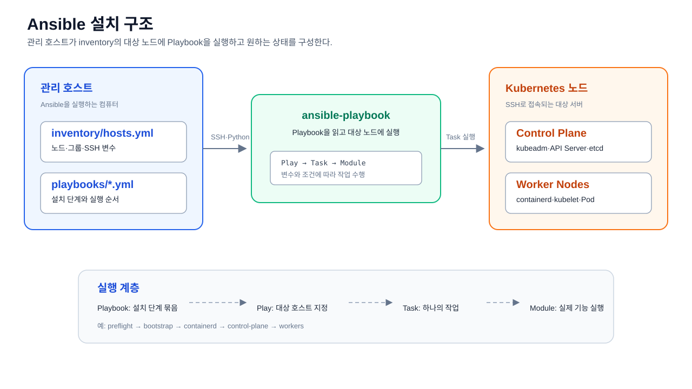

# Kubernetes 설치 Playbook 실행 순서

모든 명령은 `k8s/install` 디렉터리에서 실행한다.

> 이 설치 실습의 대상 클러스터는 ARM64 기반이다. 이미지나 Addon을 추가할 때
> ARM64 지원 여부를 먼저 확인하고, AMD64 전용 이미지는 사용하지 않는다.

## Ansible 기본 구조

이 디렉터리에서는 관리 호스트가 `inventory`에 정의된 Kubernetes 노드에
Playbook을 실행한다.



구성요소 간 실행 흐름은 [Ansible 설치 구조 SVG](../ansible-structure.svg)에서
확인할 수 있다.

```text
install/
├── inventory/hosts.yml       # 접속할 노드, 그룹, SSH 변수
└── playbooks/
    ├── preflight.yml         # Playbook: 실행할 작업 묶음
    ├── bootstrap.yml
    ├── control-plane.yml
    ├── workers.yml
    └── addons/               # Addon별 Playbook
```

```text
ansible-playbook
  └── Playbook
      └── Play
          └── Task
              └── Module
```

- `inventory`: 대상 노드와 `control_plane`, `workers` 같은 그룹을 정의한다.
- `playbook`: 특정 설치 단계의 실행 순서를 정의하는 YAML 파일이다.
- `play`: 어떤 호스트 그룹에 작업을 적용할지 지정한다.
- `task`: 하나의 작업 단위이며 `ansible.builtin.apt`, `copy`, `template`,
  `service` 같은 Module을 호출한다.
- `variable`: 버전, 주소, 경로처럼 환경에 따라 달라지는 값을 분리한다.
- `handler`: 설정 변경 후에만 서비스 재시작처럼 후속 작업을 실행한다.

예를 들어 `preflight.yml`은 `inventory/hosts.yml`의 모든 노드를 대상으로
Python·swap·hostname·sudo 상태를 점검하는 Playbook이다. 명령은 관리 호스트에서
실행되지만 작업은 대상 노드에 적용된다.

## 실행 전 SSH 변수 설정

관리 호스트의 사용자명과 개인키 경로를 환경변수로 지정할 수 있다. 지정하지
않으면 `K8S_SSH_USER`는 `groom`, `K8S_SSH_KEY`는 현재 사용자의
`$HOME/.ssh/k8s_ed25519`를 사용한다.

키 생성과 각 노드의 공개키 등록은 [SSH 키 준비와 노드 등록](../ssh/README.md)을
먼저 완료한다.

```bash
export K8S_SSH_USER="${K8S_SSH_USER:-groom}"
export K8S_SSH_KEY="${K8S_SSH_KEY:-$HOME/.ssh/k8s_ed25519}"
```

`install/inventory/hosts.yml`은 같은 변수를 사용하므로, 환경변수를 설정한
터미널에서 Ansible 명령을 실행해야 한다.

노드 아키텍처는 사전 점검 결과와 Kubernetes 노드 정보로 확인한다.

```bash
uname -m
```

관리 호스트의 CPU 아키텍처를 확인한다.

```bash
ansible all -i inventory/hosts.yml -m setup -a 'filter=ansible_architecture'
```

Ansible이 확인한 각 노드의 아키텍처를 조회한다.

```bash
kubectl get nodes -o custom-columns=NAME:.metadata.name,ARCH:.status.nodeInfo.architecture
```

Kubernetes Node 오브젝트에 기록된 아키텍처를 확인한다.

ARM64 노드는 일반적으로 `aarch64` 또는 `arm64`로 표시된다. 컨테이너 이미지가
ARM64 manifest를 제공하지 않으면 이미지 Pull 이후 `exec format error`가 발생할
수 있으므로, 배포 전에 이미지 플랫폼을 확인한다.

## 01. 사전 점검

변경 없이 OS, 자원, Python, swap, hostname, NTP, sudo를 확인한다.

```bash
ansible-playbook -i inventory/hosts.yml playbooks/preflight.yml --ask-become-pass
```

## 02. 노드 기본 설정

swap, fstab, 커널 모듈, Kubernetes 네트워크 sysctl을 적용한다.

```bash
ansible-playbook -i inventory/hosts.yml playbooks/bootstrap.yml --ask-become-pass
```

재부팅까지 적용하려면 다음 옵션을 추가한다.

```bash
ansible-playbook -i inventory/hosts.yml playbooks/bootstrap.yml --ask-become-pass -e bootstrap_reboot=true
```

## 03. 사전 점검 재검증

bootstrap 적용 후 swap과 시스템 상태를 다시 확인한다.

```bash
ansible-playbook -i inventory/hosts.yml playbooks/preflight.yml --ask-become-pass
```

## 04. containerd 설치

containerd를 설치하고 systemd cgroup을 활성화한다.

```bash
ansible-playbook -i inventory/hosts.yml playbooks/containerd.yml --ask-become-pass
```

## 05. Kubernetes 패키지 설치

Kubernetes 저장소를 등록하고 `kubeadm`, `kubelet`, `kubectl`을 설치한 뒤
패키지 버전을 고정한다.

```bash
ansible-playbook -i inventory/hosts.yml playbooks/kubernetes-packages.yml --ask-become-pass
```

실행 전 `kubernetes-packages.yml`의 `kubernetes_minor_version`이 사용할
Kubernetes minor 버전과 일치하는지 확인한다.

## 06. Control Plane 초기화

`cp-01`에서만 `kubeadm init`을 실행하고, 관리 사용자용 kubeconfig를 구성한다.
`--pod-network-cidr`는 이후 설치할 CNI 설정과 일치해야 한다.

```bash
ansible-playbook -i inventory/hosts.yml playbooks/control-plane.yml --ask-become-pass
```

이 단계는 실제 클러스터를 생성한다. `control_plane_advertise_address`와
`pod_network_cidr`를 확인한 뒤 실행한다.

## 07. Calico CNI 설치

Control Plane에서 Calico CNI manifest를 적용하고 Calico DaemonSet과 노드 상태를
확인한다. Calico manifest는 `control-plane.yml`에서 지정한
`192.168.0.0/16` Pod CIDR을 기준으로 사용한다.

```bash
ansible-playbook -i inventory/hosts.yml \
  playbooks/addons/cni-calico.yml --ask-become-pass
```

Calico는 Worker 조인 전에 필요한 기본 CNI이므로 기본 설치에서는 이 단계에서
실행한다. 기본 설치가 이미 끝난 클러스터에서 다른 Addon과 함께 다시 확인하려면
`playbooks/addons.yml`을 사용할 수 있다.

## 08. Worker 노드 조인

Control Plane에서 join 명령을 생성해 Worker 노드에 실행하고, 마지막에 전체 노드
상태를 확인한다. join 토큰은 Ansible 로그에 출력하지 않는다.

```bash
ansible-playbook -i inventory/hosts.yml playbooks/workers.yml --ask-become-pass
```

Control Plane 초기화와 Worker 조인 후에는 설치 Playbook이 모든 노드의 kubelet에
`serverTLSBootstrap: true`를 설정한다. kubelet Serving Certificate는 노드의
HTTPS `10250` 포트에 사용된다.

### CSR이 필요한 이유

CSR(`CertificateSigningRequest`)은 kubelet이 자신의 HTTPS Serving Certificate를
발급해 달라고 Kubernetes에 요청하는 리소스다. 이 인증서는 Metrics Server나
운영 도구가 kubelet의 `10250` 포트에 안전하게 접근할 때 사용된다.

`serverTLSBootstrap: true`를 설정하면 kubelet이 CSR을 생성하지만, 기본 CSR
승인 컨트롤러는 kubelet Serving Certificate를 자동 승인하지 않는다. 따라서
관리자가 요청 내용을 검토한 뒤 승인해야 한다. CSR 승인은 인증서 발급을
허용하는 작업이므로, 확인하지 않은 요청을 일괄 승인하지 않는다.

### CSR 확인 및 승인

먼저 대기 중인 CSR과 상태를 확인한다.

```bash
kubectl get csr
```

현재 클러스터의 CSR 목록과 승인 상태를 확인한다.

```bash
kubectl get csr -o wide
```

CSR의 요청자, 인증서 상태와 추가 정보를 넓은 형식으로 확인한다.

`Pending` 상태인 CSR 중 `kubernetes.io/kubelet-serving` 서명 요청만 선택한다.
다음 항목을 확인한 뒤 승인한다.

- 요청자(`Subject`)가 해당 kubelet인지
- 요청한 노드의 IP·DNS SAN만 포함하는지
- 용도가 kubelet Serving Certificate인지
- 알 수 없는 사용자, 노드, 외부 주소가 포함되지 않았는지

선택한 CSR의 상세 내용을 확인한다.

```bash
kubectl describe csr <serving-csr-name>
```

선택한 Serving CSR의 요청 내용과 Subject·SAN을 상세 확인한다.

```bash
kubectl certificate approve <serving-csr-name>
```

검토가 끝난 CSR 하나를 승인한다.

승인 후 인증서가 발급되었는지 확인한다.

```bash
kubectl get csr <serving-csr-name> -o wide
```

승인된 CSR의 `Approved`·`Issued` 상태를 확인한다.

```bash
kubectl describe csr <serving-csr-name>
```

발급 결과와 CSR 이벤트를 상세 확인한다.

### CSR 일괄 승인

노드가 여러 대이거나 kubelet이 재시작되어 동일한 Serving CSR이 여러 개
생성되었을 때 사용할 수 있다. 모든 CSR을 무조건 승인하지 말고,
`kubernetes.io/kubelet-serving` 서명자이면서 `Pending`인 요청만 대상으로 한다.

먼저 일괄 승인 대상을 출력한다.

```bash
kubectl get csr --no-headers | \
  awk '$3 == "kubernetes.io/kubelet-serving" && $6 == "Pending" {print $1}'
```

출력된 CSR의 요청자와 노드가 모두 현재 클러스터의 kubelet인지 확인한다.
알 수 없는 요청자, 외부 주소, `Denied` 상태의 요청은 승인하지 않는다.

검토가 끝난 Pending Serving CSR만 일괄 승인한다.

```bash
for csr in $(kubectl get csr --no-headers | \
  awk '$3 == "kubernetes.io/kubelet-serving" && $6 == "Pending" {print $1}'); do
  kubectl certificate approve "$csr"
done
```

각 노드의 최신 CSR만 승인하고 오래된 중복 CSR은 보류할 수도 있다. 일괄 승인
후에는 발급 상태를 확인한다.

```bash
kubectl get csr
```

승인된 요청에 `Approved,Issued`가 표시되어야 한다.

정상적인 CSR은 `Approved`와 `Issued` 상태를 확인할 수 있다. 모든 노드의
Serving Certificate가 발급된 뒤 Metrics Server를 설치한다. Metrics Server에서
`x509`, `10250`, `certificate` 관련 오류가 발생하면 CSR 승인 여부와 노드 주소를
먼저 확인한다.

## 09. Mac 관리 호스트에서 kubectl 사용

Python 가상환경은 `kubectl`을 설치하지 않으므로 Mac에 별도로 설치해야 한다.

```bash
brew install kubectl
```

Mac 관리 호스트에 kubectl을 설치한다.

```bash
kubectl version --client
```

설치된 kubectl 클라이언트 버전을 확인한다.

Control Plane에서 관리 사용자용 kubeconfig를 복사한다.

```bash
mkdir -p ~/.kube
```

관리 호스트의 kubeconfig 디렉터리를 준비한다.

```bash
scp -i "$K8S_SSH_KEY" \
  "$K8S_SSH_USER@10.10.10.150:/home/$K8S_SSH_USER/.kube/config" \
  ~/.kube/k8s-config
```

Control Plane의 관리자 kubeconfig를 관리 호스트로 복사한다.

```bash
chmod 600 ~/.kube/k8s-config
```

kubeconfig에 관리자 외 사용자가 접근하지 못하도록 권한을 설정한다.

```bash
export KUBECONFIG=$HOME/.kube/k8s-config
```

현재 터미널에서 사용할 kubeconfig 경로를 지정한다.

클러스터 연결을 확인한다.

```bash
kubectl get nodes -o wide
```

클러스터의 노드 상태와 주소를 확인한다.

```bash
kubectl get pods -A
```

모든 Namespace의 Pod 상태를 확인한다.

매번 환경 변수를 입력하지 않으려면 zsh 설정에 등록한다.

```bash
echo 'export KUBECONFIG=$HOME/.kube/k8s-config' >> ~/.zshrc
source ~/.zshrc
```

`~/.kube/k8s-config`는 관리자 권한이 포함된 kubeconfig이므로 파일 권한을
`600`으로 유지하고 저장소에 커밋하지 않는다.

## 다음 단계

Mac에서 kubeconfig 설정을 완료한 뒤 CoreDNS, Calico, kube-system Pod 상태와
Pod 간 통신을 검증한다.

## 다음 단계: Addon 별도 관리

기본 Kubernetes 설치와 Addon 설치는 별도 작업으로 관리한다. 설치 Playbook은
노드·containerd·kubeadm·CNI·kubeconfig 준비까지만 담당한다.

클러스터 설치가 끝나면 다음 문서에서 실습에 필요한 Addon을 선택해 설치하고
검증한다.

- [Addon 설치 순서](../addons/README.md)
- [Addon Playbook 실행](./addons/README.md)
- [운영 Addon 자료](../../operations/07-addons/README.md)
- [클러스터 아키텍처 점검](../../operations/01-cluster/README.md#이미지-아키텍처-사전-점검)

Addon이 필요한 실습은 해당 Addon의 설치·확인 완료 후 시작한다.
