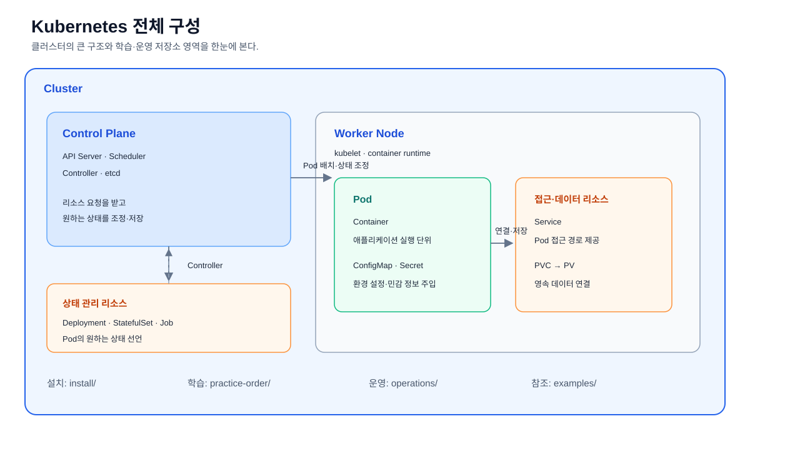
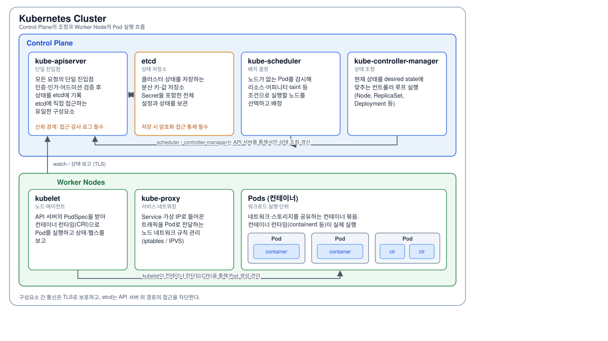
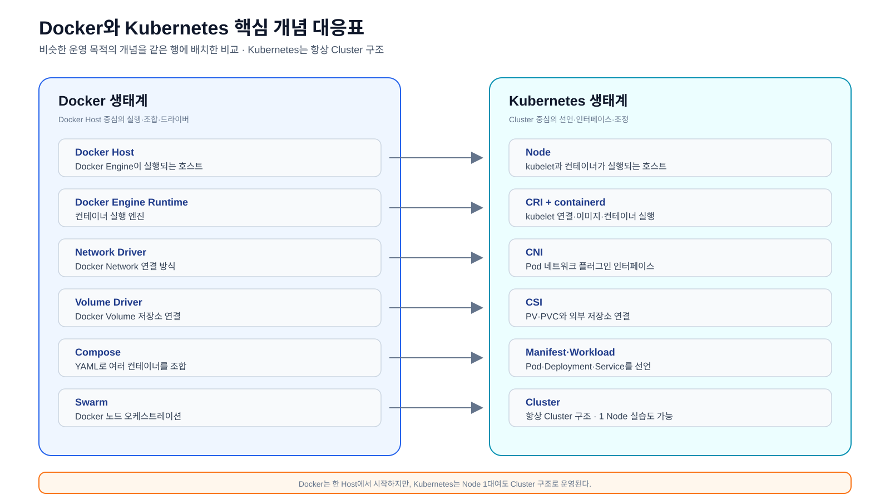

# Kubernetes 구조와 매니페스트 리소스 운영

문서 이동: [Operations 홈](../README.md) · [다음: 클러스터 운영](../01-cluster/README.md)

Kubernetes 전체 구성과 Control Plane·Node 관계는
[기본 구조 SVG](./kubernetes-basic-structure.svg)에서 먼저 확인한다.

## 1. Kubernetes 기본 구조

기본 구조 설명은 별도 하위 디렉터리로 나누지 않고 이 문서와 SVG에서 함께 관리한다.
세 SVG는 서로 다른 관점으로 구성한다.

| 자료 | 설명 |
| --- | --- |
| [전체 구성 SVG](./kubernetes-basic-structure.svg) | 클러스터와 저장소 영역의 큰 관계 |
| [클러스터 내부 구성 SVG](./kubernetes-architecture.svg) | Control Plane과 Node의 동작 |
| [핵심 특징 SVG](./kubernetes-features.svg) | 리소스·배포·확장 관점의 학습 포인트 |






모든 구조 SVG는 PowerPoint 와이드 화면 비율인 `16:9`와 `viewBox="0 0 1280 720"`을
기준으로 작성하며, 제목과 본문이 겹치지 않도록 구성한다.

Kubernetes 운영은 클러스터 구조를 이해한 뒤, 매니페스트가 선언한 리소스와
클러스터의 실제 상태를 비교하는 순서로 진행한다.



Docker와 Kubernetes의 역할 및 핵심 키워드는 [비교 SVG](./docker-kubernetes-comparison.svg)에서
확인한다. Docker는 Docker Host에서 컨테이너를 실행하고 Compose·Swarm으로 조합할 수
있다. Kubernetes는 Cluster에서 CRI·CNI·CSI를 통해 런타임·네트워크·스토리지를
분리하고 원하는 상태를 유지한다.

Docker는 일반적으로 하나의 Docker Host에서 컨테이너를 실행한다. 반면 Kubernetes는
Node가 1대뿐인 실습 환경에서도 API Server·Scheduler·Controller를 포함한 Cluster
구조로 운영한다. 따라서 Kubernetes의 Cluster는 반드시 여러 대의 물리 또는 가상
Node를 의미하지 않으며, 클러스터 운영 모델을 의미한다.

가장 가까운 개념 연결은 다음과 같다. 서로 완전히 같은 기능이 아니라 추상화
계층과 운영 목적이 비슷한 항목을 비교한다.

| Docker | Kubernetes | 비교 기준 |
| --- | --- | --- |
| Docker Host | Node | 컨테이너가 실행되는 호스트 |
| Compose | Manifest·Deployment·Service | 애플리케이션 구성과 실행 선언 |
| Swarm | Cluster | 여러 실행 단위를 관리하는 오케스트레이션 |
| Network Driver | CNI | 컨테이너·Pod 네트워크 연결 |
| Volume Driver | CSI | 외부 또는 영속 스토리지 연결 |
| Docker Engine Runtime | CRI + containerd/CRI-O | kubelet과 컨테이너 런타임 연결 |

## 2. 컨테이너 런타임 계층

Kubernetes에서 이미지 빌드 도구와 Pod를 실제로 실행하는 런타임은 구분해야 한다.
Docker CLI로 이미지를 빌드하고 Registry에 Push하더라도 Kubernetes Node가 반드시
Docker Engine을 실행해야 하는 것은 아니다. OCI 호환 이미지는 `containerd` 또는
`CRI-O`에서도 실행할 수 있다.

```text
kubelet
  │  CRI v1(gRPC)
  ▼
containerd 또는 CRI-O       # Kubernetes와 연결되는 고수준 런타임
  │
  ├── 이미지 Pull·캐시
  ├── Pod sandbox와 컨테이너 수명주기 관리
  └── runc 등 OCI Runtime 호출
        │
        ▼
      runc                  # 실제 Linux 컨테이너 프로세스 생성
```

| 이름 | 계층 | 역할 |
| --- | --- | --- |
| `kubelet` | Kubernetes Node Agent | Pod 상태를 관리하고 CRI 요청을 보냄 |
| `CRI` | 표준 인터페이스 | kubelet과 런타임 사이의 gRPC 계약 |
| `containerd` | 고수준 컨테이너 런타임 | 이미지·sandbox·컨테이너 수명주기 관리 |
| `CRI-O` | 고수준 컨테이너 런타임 | Kubernetes CRI에 맞춘 런타임 |
| `runc` | 저수준 OCI 런타임 | Linux namespace·cgroup 기반 프로세스 실행 |
| `pause` 이미지 | Pod sandbox | Pod 네트워크 namespace를 유지하는 기반 컨테이너 |
| Docker Engine | 이미지 빌드·개발 도구 또는 별도 런타임 | Kubernetes 기본 런타임이라는 의미와 구분 |

Kubernetes 1.24부터 내장 `dockershim`이 제거되었으므로, 현재 설치에서는
`containerd` 또는 `CRI-O`처럼 CRI v1을 지원하는 런타임을 사용한다. 이 프로젝트의
설치 구성은 `containerd`와 `/run/containerd/containerd.sock`을 사용한다.

```bash
kubectl get nodes -o custom-columns=NAME:.metadata.name,VERSION:.status.nodeInfo.kubeletVersion,RUNTIME:.status.nodeInfo.containerRuntimeVersion
```

각 Node가 보고한 Kubernetes 버전과 컨테이너 런타임 이름·버전을 확인한다.

```bash
kubectl describe node <노드이름>
```

`Container Runtime Version` 항목에서 해당 Node의 런타임을 상세히 확인한다.

```bash
crictl info
```

Node에서 실행하면 CRI endpoint가 응답하는지와 런타임 정보를 확인한다. 이 명령은
관리 Mac이 아니라 해당 Kubernetes Node에서 실행해야 한다.

설치 파일은 [containerd Playbook](../../install/playbooks/containerd.yml)과
[설치 실행 순서](../../install/playbooks/README.md#04-containerd-설치)에서 확인한다.

공식 참고: [Kubernetes Container Runtimes](https://kubernetes.io/docs/setup/production-environment/container-runtimes/),
[CRI](https://kubernetes.io/docs/concepts/containers/cri/),
[Runtime Class](https://kubernetes.io/docs/concepts/containers/runtime-class/)

## 3. Kubernetes 구조

```text
Cluster
├── Control Plane
│   ├── kube-apiserver       # 모든 리소스 요청의 진입점
│   ├── etcd                 # 클러스터 상태 저장소
│   ├── scheduler             # Pod 배치 노드 결정
│   └── controller-manager    # 선언 상태와 실제 상태 조정
├── Node
│   ├── kubelet               # 노드의 Pod 실행·상태 보고
│   ├── kube-proxy            # Service 네트워크 처리
│   └── Container Runtime     # 컨테이너 실행
└── 선택 확장 구성요소
    ├── CNI                  # Pod 네트워크
    ├── CSI                  # 외부 스토리지 연결
    ├── Ingress Controller   # 외부 HTTP 라우팅
    └── Metrics Server       # CPU·메모리 지표 제공
```

리소스 관점에서는 다음과 같이 연결된다.

```text
Manifest
  └── Kubernetes API Server
      └── Resource
          ├── Namespace
          ├── Workload: Pod, Deployment, StatefulSet, DaemonSet, Job
          ├── Network: Service, Ingress, NetworkPolicy
          ├── Storage: PV, PVC, StorageClass
          ├── Configuration: ConfigMap, Secret
          └── Access: ServiceAccount, Role, RoleBinding
```

`Deployment`와 `StatefulSet`은 원하는 상태를 선언하고 Controller가 ReplicaSet·Pod를
생성하고 조정한다. `Service`는 Pod를 생성하지 않고 selector로 Pod를 찾아 안정적인
네트워크 진입점을 제공한다.

## 4. 매니페스트의 기본 구조

```yaml
apiVersion: apps/v1       # 사용할 Kubernetes API 그룹과 버전
kind: Deployment           # 생성할 리소스 종류
metadata:                  # 이름, Namespace, label, annotation
  name: example
spec:                      # 사용자가 선언하는 원하는 상태
  replicas: 1
```

| 영역 | 역할 | 점검할 항목 |
| --- | --- | --- |
| `apiVersion` | API 스키마 선택 | 클러스터에서 지원하는 버전인지 확인 |
| `kind` | 리소스 종류 선택 | `kubectl api-resources`와 일치하는지 확인 |
| `metadata` | 식별·분류 정보 | `name`, `namespace`, `labels`, `annotations` |
| `spec` | 원하는 상태 선언 | 이미지, selector, 포트, 볼륨, replica |
| `status` | Controller가 기록한 현재 상태 | `kubectl get`·`describe`로 확인 |

`spec`은 사용자가 선언하는 값이고 `status`는 Kubernetes가 계산해 기록하는 값이다.
일반적으로 `status`를 직접 매니페스트에 작성하지 않는다.

## 5. 리소스 종류와 조회 범위

```bash
kubectl api-resources
```

현재 클러스터가 지원하는 리소스의 이름, ShortName, API 그룹, Namespace 범위를
확인한다.

```bash
kubectl explain deployment
```

Deployment의 최상위 필드와 설명을 확인한다.

```bash
kubectl explain deployment.spec.template.spec.containers
```

컨테이너 이미지·포트·환경변수처럼 깊은 필드의 스키마를 확인한다.

```bash
kubectl get pods -n default
```

지정한 Namespace의 Pod 목록과 상태를 확인한다.

```bash
kubectl get pods -A
```

모든 Namespace의 Pod를 확인한다.

```bash
kubectl get deployment,service,configmap,secret -n default
```

한 Namespace의 애플리케이션 관련 리소스를 종류별로 함께 확인한다.

```bash
kubectl get -f practice-order/10-3tier/frontend.yml
```

매니페스트 파일에 선언된 리소스의 현재 상태를 확인한다. 파일을 적용하지 않아도
조회할 수 있지만, 해당 이름의 리소스가 클러스터에 있어야 한다.

## 6. 매니페스트 적용 전후 명령

```bash
kubectl diff -f practice-order/10-3tier/frontend.yml
```

현재 클러스터와 매니페스트의 차이를 확인한다. 리소스 자체를 변경하지 않는다.

```bash
kubectl apply -f practice-order/10-3tier/frontend.yml
```

매니페스트의 원하는 상태를 클러스터에 선언한다.

```bash
kubectl get -f practice-order/10-3tier/frontend.yml
```

적용한 리소스가 생성되었는지 확인한다.

```bash
kubectl describe deployment frontend -n default
```

Deployment의 selector, ReplicaSet, 이벤트, Pod 상태를 상세히 확인한다.

```bash
kubectl get pod -l app=frontend -n default -o wide
```

label selector로 연결된 Pod와 배치 노드를 확인한다.

```bash
kubectl get deployment frontend -n default -o yaml
```

API Server에 저장된 Deployment의 현재 YAML을 확인한다. 기본값이 추가되거나
Controller가 기록한 정보가 포함될 수 있으므로 원본 파일과 구분한다.

```bash
kubectl delete -f practice-order/10-3tier/frontend.yml
```

해당 파일에 선언된 리소스를 삭제한다. StatefulSet의 PVC처럼 별도로 보존되는
리소스가 있는지 먼저 확인한다.

## 7. 운영 점검 순서

```text
구조 확인
  → api-resources / explain으로 스키마 확인
  → kubectl diff로 변경 검토
  → kubectl apply로 선언
  → get으로 요약 상태 확인
  → describe·logs·events로 원인 확인
  → 필요 시 delete 또는 매니페스트 수정
```

리소스의 상태가 예상과 다르면 다음 기준으로 범위를 좁힌다.

1. 리소스가 생성되었는지 `kubectl get`으로 확인한다.
2. Controller가 만든 하위 리소스가 연결되었는지 label과 selector를 확인한다.
3. 이벤트와 로그에서 이미지, 스케줄링, Probe, 볼륨 오류를 확인한다.
4. Service라면 Endpoint 또는 EndpointSlice에 준비된 Pod가 있는지 확인한다.
5. PVC라면 StorageClass, CSI Driver, PV 바인딩 상태를 확인한다.

## 관련 운영 영역

- [클러스터 운영](../01-cluster/README.md)
- [노드 운영](../02-nodes/README.md)
- [워크로드 운영](../03-workloads/README.md)
- [네트워크 운영](../04-network/README.md)
- [스토리지 운영](../05-storage/README.md)
- [장애 분석](../06-troubleshooting/README.md)
