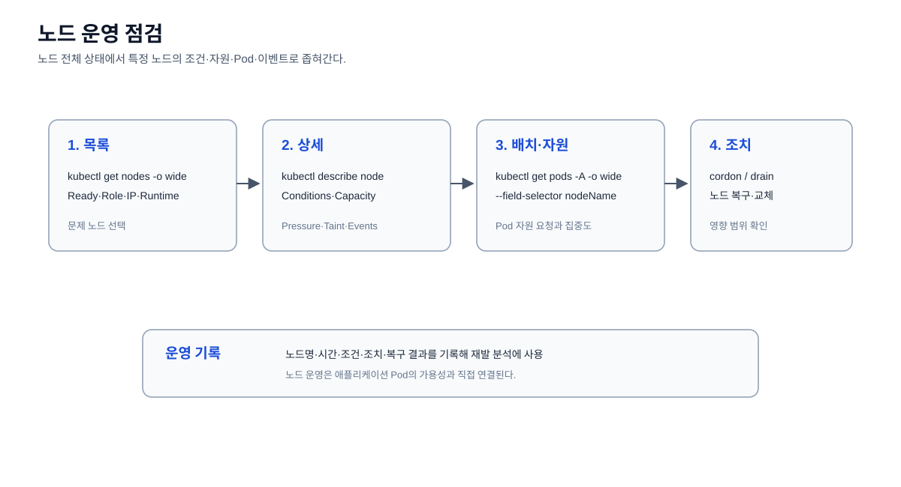

# Kubernetes 노드 운영 및 상태 관리

문서 이동: [이전: 클러스터 운영](../01-cluster/README.md) · [Operations 홈](../README.md) · [다음: 워크로드 운영](../03-workloads/README.md)

Kubernetes 노드의 상태, 역할, IP, 운영체제, 커널, 컨테이너 런타임을 확인하는
운영 명령을 정리한다.

## 문서 목록

- [노드 목록 조회](./get-nodes.md)
- [노드 상세 정보 확인](./describe-node.md)
- [Node Taint 운영](./taint.md)

## 분류 기준

- `k8s/practice-order/17-cluster-scoped/`: Node와 같은 리소스의 선언적 YAML
- `k8s/operations/07-addons/`: 필요할 때 확장 구성요소의 상태를 확인하는 운영 참고 자료
- `k8s/operations/02-nodes/`: `kubectl`을 이용한 노드 운영·점검 명령
