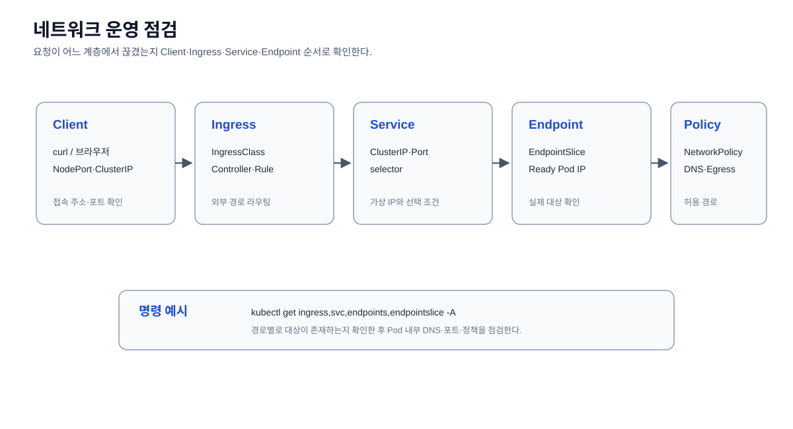

# 네트워크 운영

문서 이동: [이전: 워크로드 운영](../03-workloads/README.md) · [Operations 홈](../README.md) · [다음: 스토리지 운영](../05-storage/README.md)

Service, Ingress, Endpoint와 Pod 간 통신 상태를 확인한다.



## Service 확인

```bash
kubectl get services -A
```

모든 Namespace의 Service, ClusterIP, 포트와 연결 selector를 확인한다.

## Ingress 확인

```bash
kubectl get ingress -A
```

Namespace별 Ingress 규칙과 외부 라우팅 대상을 확인한다.

## Endpoint 확인

```bash
kubectl get endpoints -A
```

Service selector에 의해 실제로 선택된 Pod IP와 포트를 확인한다.
