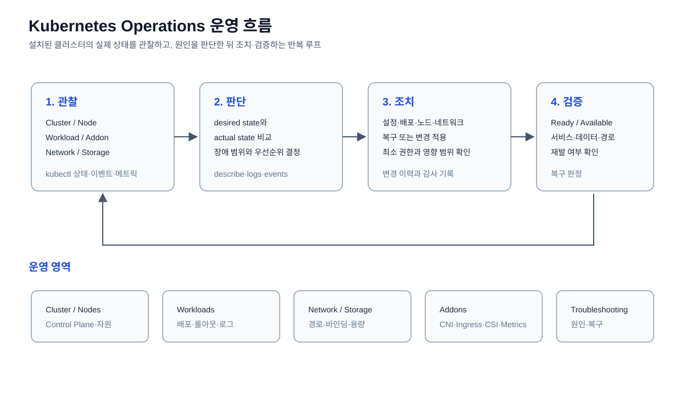
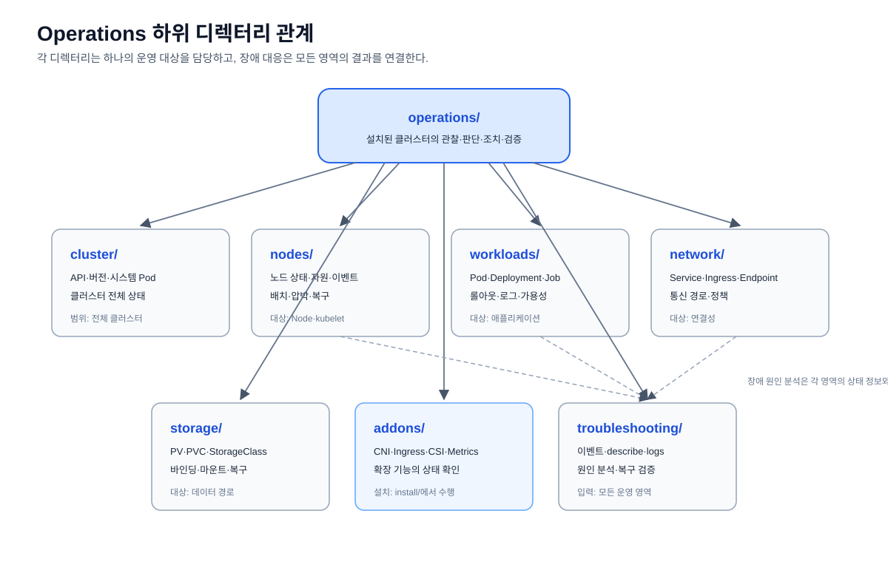

# Kubernetes 운영

Operations의 범위와 Addon 하위 영역의 관계는
[Operations 이론](./operations-theory.md)에서 먼저 확인한다.

설치가 완료된 클러스터를 조회·점검·문제 해결하는 운영 명령을 관리한다.

Kubernetes의 기본 구성과 리소스 관계는 먼저 [기본 구조 문서](../structure/README.md)에서
확인한다.





구성요소 관계는 [Kubernetes 클러스터 구성도](../structure/kubernetes-architecture.svg)와
[오버레이 네트워크 흐름도](./network/kubernetes-overlay-network.svg),
[Kubernetes 특징](../structure/kubernetes-features.svg)에서 확인한다.

```text
k8s/operations/
├── operations-theory.md # Operations 개념과 하위 영역 이론
├── cluster/          # 클러스터 전체 상태와 기본 정보
├── nodes/            # 노드 상태·자원·이벤트
├── workloads/        # Pod·Deployment·Job 상태
├── network/          # Service·Ingress·Endpoint 통신
├── storage/          # PV·PVC·StorageClass 상태
├── addons/           # Operations 하위 Addon 확인과 운영 참고
└── troubleshooting/  # 장애 분석과 이벤트 확인
```

`practice-order/`는 선언할 리소스 YAML을, `operations/`는 이미 설치된 클러스터와
Addon을 점검하는 명령과 참고 자료를 관리한다.

## 하위 디렉터리 관계

| 디렉터리 | 운영 대상 | 다른 영역과의 관계 |
| --- | --- | --- |
| `cluster/` | API Server, 버전, 시스템 Pod | 전체 운영 점검의 시작점 |
| `nodes/` | Node, kubelet, 자원, 이벤트 | 워크로드가 배치되는 실행 기반 |
| `workloads/` | Pod, Deployment, StatefulSet, Job | 애플리케이션 desired state와 실제 상태 |
| `network/` | Service, Ingress, Endpoint, 정책 | 외부 요청과 Pod 간 통신 경로 |
| `storage/` | PV, PVC, StorageClass | 워크로드의 데이터 연결과 보존 |
| `addons/` | CNI, Ingress Controller, CSI, Metrics | 설치된 확장 기능의 운영 상태 |
| `troubleshooting/` | 이벤트, describe, logs | 모든 영역의 장애 분석과 복구 검증 |

`cluster/`와 `nodes/`는 기반 상태를 확인하고, `workloads/`, `network/`,
`storage/`, `addons/`는 서비스 구성요소를 점검한다. 문제가 발생하면
`troubleshooting/`에서 각 영역의 상태·이벤트·로그를 모아 원인을 분석한다.
