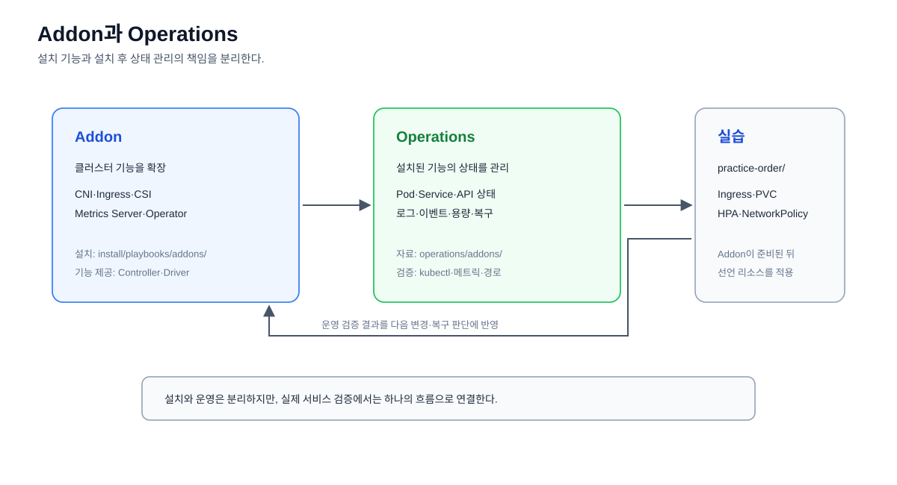

# 운영 Addon 자료

Addon은 Operations의 하위 운영 영역이다. 전체 관계는
[Operations 이론](../operations-theory.md)에서
먼저 확인한다.

컨트롤러는 Kubernetes 오브젝트를 감시하고 선언된 원하는 상태가 실제 상태가
되도록 조정하는 구성 요소다.



```text
k8s/operations/addons/
├── cni/
├── ingress/
├── storage/
├── autoscaling/
└── operators/
```

## 관리 기준

- `practice-order/`: `Deployment`, `Service` 등 원하는 상태를 선언하는 YAML
- `operations/addons/`: 설치된 Addon의 확인과 운영 참고 자료
- `install/`: Lesson 0 노드와 Kubernetes 기본 구성 설치
- `operations/`: 설치 후 상태 확인과 운영 명령

Addon 설치는 [Addon 설치 순서](../../install/addons/README.md)에서 별도로
관리한다. 설치 스크립트도 `install/addons/`에서 관리하며, 이 디렉터리는 설치
후 상태 확인과 운영 참고 자료를 담당한다.

Kubernetes 기본 컨트롤러(`Deployment Controller`, `Node Controller` 등)는
Control Plane 내부에서 실행되므로 이 디렉터리에 별도 설치 YAML을 두지 않는다.
