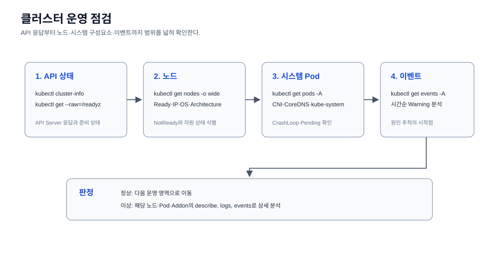

# 클러스터 운영

클러스터 전체 상태, Kubernetes 버전, API Server와 시스템 Pod 상태를 확인한다.



예정 명령:

```bash
kubectl cluster-info
kubectl version
kubectl get --raw='/readyz?verbose'
kubectl get pods -A
```

## 이미지 아키텍처 사전 점검

Kubernetes 노드의 CPU 아키텍처와 컨테이너 이미지의 지원 아키텍처가 다르면
이미지를 정상적으로 Pull해도 컨테이너 시작 시 `exec format error`가 발생할 수
있다. 실습 전에 다음 스크립트로 노드와 주요 이미지의 `linux/arm64`,
`linux/amd64` 지원 여부를 확인한다.

```bash
cd /Users/jarrod/project/code-test-check/k8s/operations/cluster
bash ./check-architecture.sh
```

이 점검은 Docker Registry의 이미지 manifest를 조회하며 클러스터 리소스를
변경하지 않는다. `docker buildx imagetools`와 현재 클러스터에 연결된
`kubectl`이 필요하다.

### 현재 실습 클러스터 기록

2026-10-11 점검 결과 현재 클러스터의 모든 노드는 `arm64`였다.

- `node-01`: `arm64`
- `node-02`: `arm64`
- `ub24-00`: `arm64`
- 기존 `itsthenetwork/nfs-server-alpine:latest`는 이 클러스터에서 실행되지
  않고 `exec format error`로 재시작되었다.
- 현재 08-storage는 ARM64·AMD64를 지원하는
  `andrewkidd/nfs-server:v2.2.7`을 사용하도록 변경했다.
- 이 이미지도 노드 커널의 `nfs`·`nfsd` 모듈이 필요하므로
  `nfs-kernel-modules.yml`을 먼저 적용해야 한다.
- NFS CSI Driver가 설치되지 않은 클러스터에서는 이미지 문제를 해결해도 PVC가
  `Pending` 상태로 남는다.

AMD64 노드가 추가되거나 실습 클러스터가 AMD64 환경으로 변경되면 이 기록을
현재 `kubectl get nodes -o wide` 결과와 이미지 manifest 점검 결과로 갱신한다.
