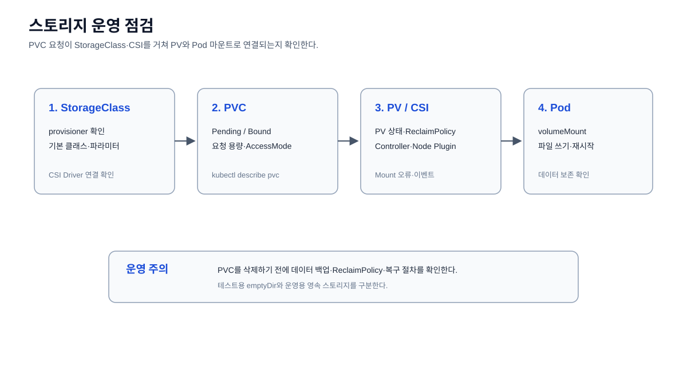

# 스토리지 운영

PersistentVolume, PersistentVolumeClaim, StorageClass의 바인딩과 상태를
확인한다.



## PersistentVolume 확인

```bash
kubectl get pv
```

클러스터에 등록된 PersistentVolume의 상태와 Claim 바인딩을 확인한다.

## PersistentVolumeClaim 확인

```bash
kubectl get pvc -A
```

모든 Namespace의 PVC가 `Bound` 상태인지 확인한다.

## StorageClass 확인

```bash
kubectl get storageclass
```

동적 볼륨 프로비저닝에 사용할 StorageClass와 기본 클래스를 확인한다.
