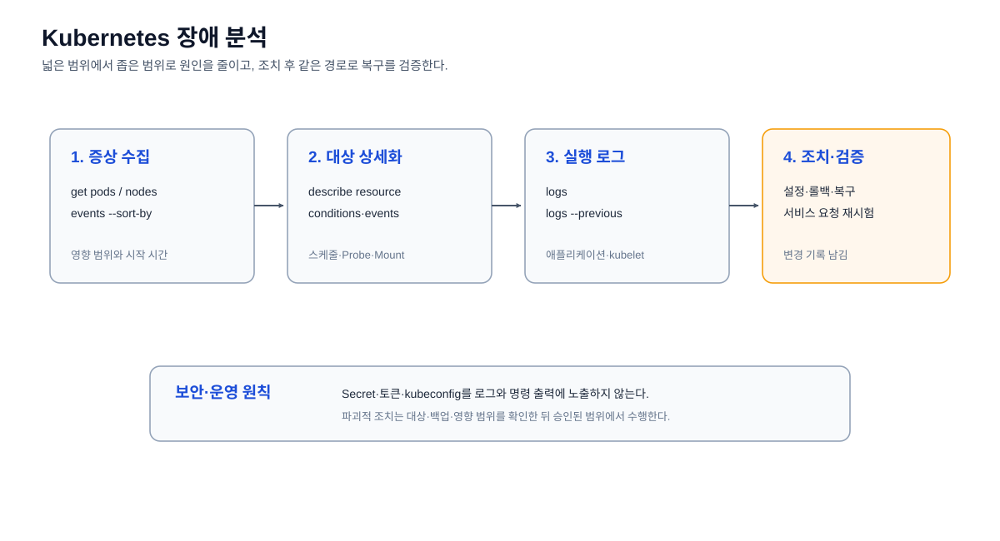

# 장애 분석

노드·Pod·네트워크 장애의 원인을 이벤트, 상태, 로그 순서로 확인한다.



## 최근 이벤트 확인

```bash
kubectl get events -A --sort-by=.lastTimestamp
```

스케줄링 실패, 이미지 Pull 오류, Probe 실패처럼 시간순으로 발생한 이벤트를
확인한다.

## 리소스 상세 확인

```bash
kubectl describe <resource> <name> -n <namespace>
```

문제가 발생한 리소스의 상태, 이벤트, selector와 연결 정보를 확인한다.

## Pod 로그 확인

```bash
kubectl logs <pod-name> -n <namespace>
```

애플리케이션 내부 오류와 시작 실패 원인을 확인한다.
