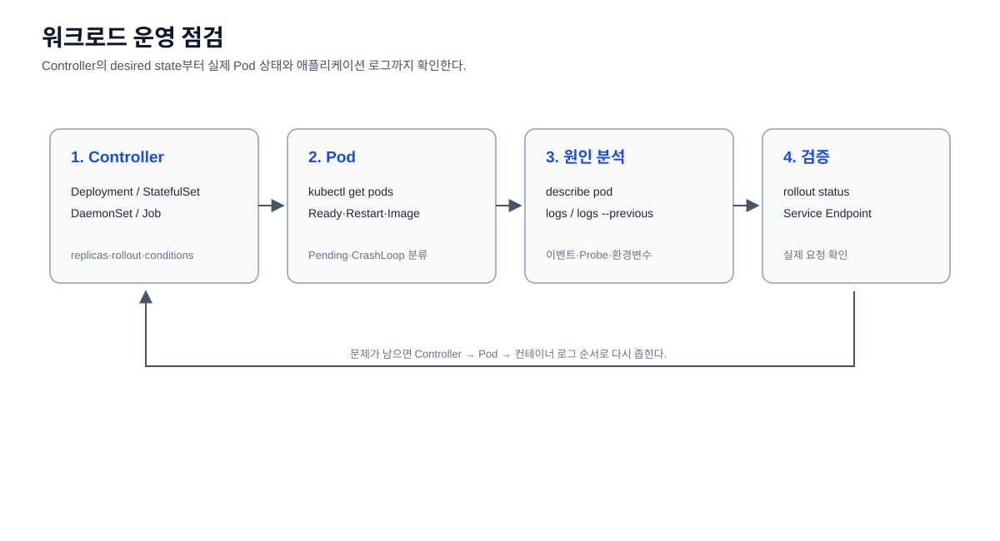

# 워크로드 운영

Pod, Deployment, StatefulSet, DaemonSet, Job, CronJob의 배포 상태와 로그를
확인한다.



## Pod 목록 확인

```bash
kubectl get pods -A
```

모든 Namespace의 Pod 상태를 한 번에 확인한다.

## Deployment 목록 확인

```bash
kubectl get deployments -A
```

모든 Namespace의 Deployment와 desired/available replica 수를 확인한다.

## Pod 상세 확인

```bash
kubectl describe pod <pod-name> -n <namespace>
```

스케줄링, 이벤트, 볼륨, 컨테이너 상태 등 특정 Pod의 상세 정보를 확인한다.

## Pod 로그 확인

```bash
kubectl logs <pod-name> -n <namespace>
```

컨테이너 애플리케이션의 표준 출력 로그를 확인한다. 다중 컨테이너 Pod는
필요한 경우 `-c <container-name>`을 추가한다.
