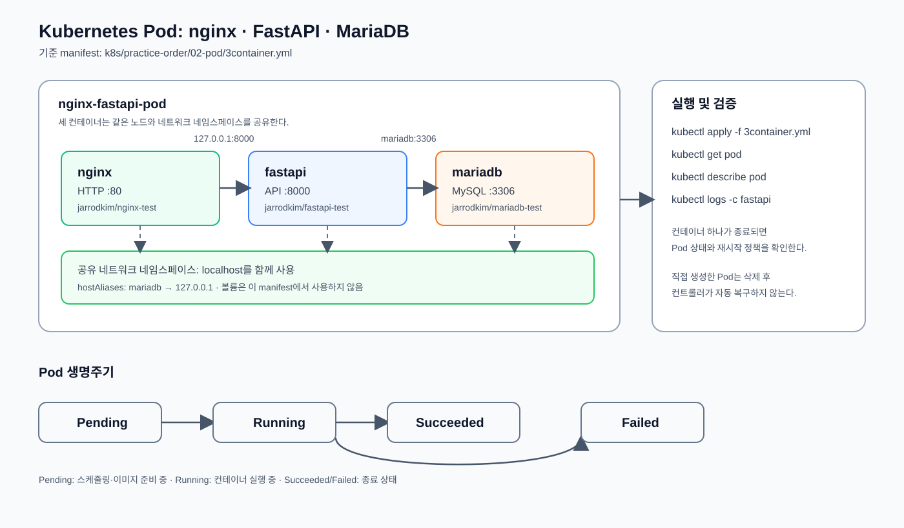

# Pod

하나 이상의 컨테이너를 묶는 Kubernetes 최소 실행 단위다.

## 구조와 생명주기



## 1·2컨테이너 Pod 실행

1컨테이너와 2컨테이너 예제는 구성 차이를 확인하고 실행하는 실습용이다.
세부적인 프록시·API·데이터베이스 통신은 3컨테이너 예제에서 확인한다.

## 사전 조건: 이미지 Pull Secret

세 예제는 `jarrodkim/*-test:latest` 이미지를 사용하며, Pod의
`spec.imagePullSecrets`에서 `jarrod-secret-test`를 참조한다. 먼저 01번 실습에서
현재 Namespace에 Secret을 생성한다. Secret이 없으면 `ImagePullBackOff`가 발생할
수 있다.

```bash
kubectl get secret jarrod-secret-test
```

Pod가 사용할 Docker Hub 인증 Secret이 현재 Namespace에 있는지 확인한다.

```bash
kubectl apply -f ../01-image-pull-secret/dockerhub-secret.yml
```

실제 토큰으로 작성한 Secret YAML을 적용한다. 템플릿 파일을 직접 적용하지 않는다.

### 1컨테이너

```bash
kubectl apply -f 1container.yml
```

1컨테이너 Pod를 생성한다.

```bash
kubectl get pod nginx-pod -o wide
```

Pod의 실행 상태와 배치된 노드를 확인한다.

```bash
kubectl logs nginx-pod -c nginx
```

nginx 컨테이너 로그를 확인한다.

```bash
kubectl delete -f 1container.yml
```

1컨테이너 Pod를 삭제한다.

### 2컨테이너

```bash
kubectl apply -f 2container.yml
```

nginx와 FastAPI가 함께 있는 2컨테이너 Pod를 생성한다.

```bash
kubectl get pod nginx-fastapi-pod -o wide
```

2컨테이너 Pod의 상태와 배치된 노드를 확인한다.

```bash
kubectl logs nginx-fastapi-pod -c nginx
```

nginx 컨테이너 로그를 확인한다.

```bash
kubectl logs nginx-fastapi-pod -c fastapi
```

FastAPI 컨테이너 로그를 확인한다.

```bash
kubectl delete -f 2container.yml
```

2컨테이너 Pod를 삭제한다.

## 3컨테이너 Pod 실행

이 디렉터리의 `3container.yml`은 하나의 Pod 안에서 다음 컨테이너를 함께 실행한다.

- `nginx`: HTTP 프록시 및 정적 파일 제공, `80` 포트
- `fastapi`: API 서버, `8000` 포트
- `mariadb`: 데이터베이스, `3306` 포트

세 컨테이너는 같은 네트워크 네임스페이스를 사용한다. 따라서 nginx는
`127.0.0.1:8000`으로 FastAPI에 접근하고, `hostAliases`로 등록된 `mariadb`는
`127.0.0.1`로 해석된다.

```bash
kubectl apply -f 3container.yml
```

nginx, FastAPI, MariaDB가 함께 있는 3컨테이너 Pod를 생성한다.

```bash
kubectl get pod nginx-fastapi-pod -o wide
```

세 컨테이너를 포함한 Pod의 실행 상태와 배치 노드를 확인한다.

```bash
kubectl describe pod nginx-fastapi-pod
```

컨테이너 상태, 이벤트, 볼륨과 네트워크 설정을 상세 확인한다.

컨테이너별 로그 확인:

```bash
kubectl logs nginx-fastapi-pod -c nginx
```

nginx 컨테이너 로그를 확인한다.

```bash
kubectl logs nginx-fastapi-pod -c fastapi
```

FastAPI 컨테이너 로그를 확인한다.

```bash
kubectl logs nginx-fastapi-pod -c mariadb
```

MariaDB 컨테이너 로그를 확인한다.

로컬에서 nginx에 접근:

```bash
kubectl port-forward pod/nginx-fastapi-pod 8080:80
```

로컬 포트 `8080`을 Pod의 nginx 포트 `80`으로 연결한다. 이 명령은 실행 중인
터미널을 계속 사용하므로 별도 터미널에서 다음 명령을 실행한다.

```bash
curl http://127.0.0.1:8080
```

Port-forward 경로를 통해 nginx 응답을 확인한다.

실습 종료:

```bash
kubectl delete -f 3container.yml
```

3컨테이너 Pod를 삭제한다.

이 예제는 `3container.yml`로 Pod 하나를 직접 실행하는 학습용 구성이다.
장애 복구, 롤링 업데이트, 스케일링이 필요한 실제 서비스는 `Deployment` 사용을
권장한다.

## 핵심 개념

- Pod는 Kubernetes에서 실행되는 가장 작은 배포 단위다.
- 하나 이상의 컨테이너를 묶으며, 같은 Pod의 컨테이너는 네트워크와
  필요에 따라 볼륨을 공유한다.
- Pod는 일시적인 리소스다. 직접 생성한 Pod가 삭제되면 자동으로 복구되지 않는다.
- 장애 복구와 스케일링이 필요하면 Pod 대신 `Deployment` 같은 컨트롤러를 사용한다.

## Pod 상태

| 상태 | 설명 |
| --- | --- |
| `Pending` | 스케줄링, 이미지 다운로드 또는 컨테이너 준비를 기다리는 상태 |
| `Running` | Pod가 노드에 배치되고 컨테이너가 실행 중인 상태 |
| `Succeeded` | 모든 컨테이너가 정상 종료된 상태 |
| `Failed` | 하나 이상의 컨테이너가 오류로 종료된 상태 |
| `Unknown` | 노드 또는 API Server와 통신할 수 없어 상태를 확인하지 못한 상태 |

`Terminating`은 Pod의 공식 phase가 아니라 삭제 처리 중임을 나타내는 표시다.
