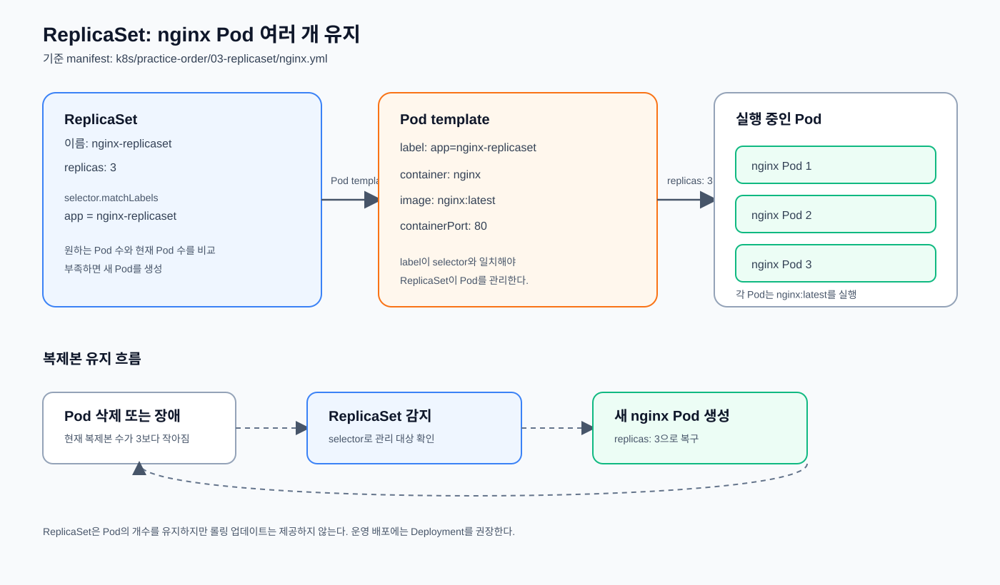

# ReplicaSet

지정한 수의 동일한 Pod 복제본을 유지하는 워크로드 오브젝트다.

일반적으로 ReplicaSet을 직접 생성하지 않고 `Deployment`가 ReplicaSet을
자동으로 생성·관리하도록 사용한다.

## nginx 여러 개 실행

테스트용으로 `jarrodkim/nginx-test:latest` Pod 3개를 유지하는 ReplicaSet 예제다.

## Pod 템플릿

ReplicaSet의 `spec.template`은 ReplicaSet이 새로 생성하거나 장애 후 다시
생성하는 Pod의 설계도다. `nginx.yml`에서는 다음 내용을 템플릿으로 정의한다.

- `template.metadata.labels`: 생성되는 Pod에 붙는 label
- `template.spec.containers`: 컨테이너 이름, 이미지, 포트
- `selector.matchLabels`: 관리할 Pod를 찾는 기준

`selector.matchLabels`와 `template.metadata.labels`의 값은 반드시 일치해야
ReplicaSet이 템플릿으로 생성한 Pod를 관리할 수 있다. 템플릿을 수정해도 이미
실행 중인 Pod가 자동으로 교체되지는 않으므로, 변경 배포에는 `Deployment`를
사용한다.

```yaml
spec:
  replicas: 3
```

전체 예제: [`nginx.yml`](./nginx.yml)

구조와 복제본 유지 흐름:



```bash
kubectl apply -f nginx.yml
```

nginx ReplicaSet을 생성하고 3개의 Pod를 유지하도록 한다.

```bash
kubectl get rs nginx-replicaset
```

ReplicaSet의 desired/current/ready replica 수를 확인한다.

```bash
kubectl get pods -l app=nginx-replicaset -o wide
```

ReplicaSet이 관리하는 Pod의 상태와 배치 노드를 확인한다.

복제본 수 변경:

```bash
kubectl scale rs nginx-replicaset --replicas=5
```

ReplicaSet이 유지할 Pod 수를 5개로 변경한다.

```bash
kubectl get pods -l app=nginx-replicaset
```

스케일링 결과로 Pod가 5개 실행 중인지 확인한다.

실습 종료:

```bash
kubectl delete -f nginx.yml
```

`jarrodkim/nginx-test:latest`는 테스트용으로만 사용한다. 운영 환경에서는 재현 가능한
버전을 위해 구체적인 이미지 태그를 고정하는 것이 좋다.

```text
Deployment
    ↓ 생성·관리
ReplicaSet
    ↓ 생성·유지
Pod
```
