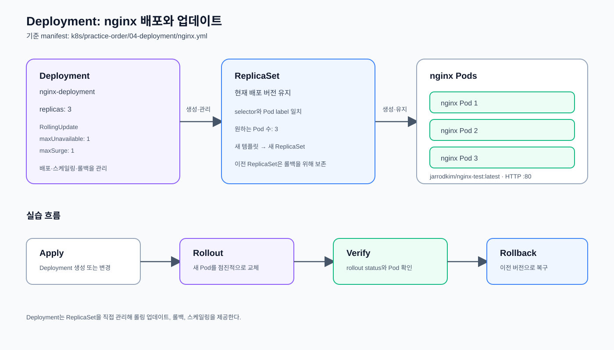

# Deployment

무상태 애플리케이션 Pod의 배포와 복제본 수 관리를 연습한다.

## nginx Deployment 실습

`nginx.yml`은 `jarrodkim/nginx-test:latest` 컨테이너를 3개의 Pod로 실행하고,
Deployment가 ReplicaSet을 통해 원하는 복제본 수를 유지하도록 구성한 예제다.

구조와 배포 흐름:



전체 예제: [`nginx.yml`](./nginx.yml)

### 배포 및 확인

```bash
kubectl apply -f nginx.yml
```

nginx Deployment를 생성한다.

```bash
kubectl wait --for=condition=available deployment/nginx-deployment --timeout=120s
```

Deployment가 지정된 수의 사용 가능한 Pod를 준비할 때까지 최대 120초 기다린다.

```bash
kubectl get deployment nginx-deployment
```

Deployment의 원하는 replica 수와 사용 가능한 replica 수를 확인한다.

```bash
kubectl get rs -l app=nginx-deployment
```

Deployment가 생성한 ReplicaSet을 확인한다.

```bash
kubectl get pods -l app=nginx-deployment -o wide
```

nginx Pod의 Ready 상태와 배치된 노드를 확인한다.

이 실습에서는 Deployment, ReplicaSet, Pod의 관계와 기본 스케일링만 다룬다.
Rolling Update와 롤백은 별도 실습인
[`24-rollout`](../24-rollout/README.md)에서 진행한다.

### 스케일링

```bash
kubectl scale deployment nginx-deployment --replicas=5
```

nginx Deployment의 원하는 Pod 수를 5개로 변경한다.

```bash
kubectl get pods -l app=nginx-deployment
```

스케일링 결과로 nginx Pod가 5개 준비되었는지 확인한다.

### 실습 종료

```bash
kubectl delete -f nginx.yml
```

nginx Deployment와 생성된 하위 리소스를 삭제한다.
