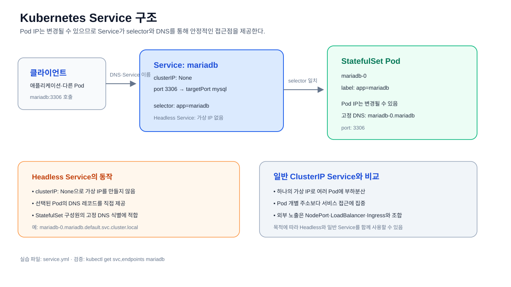

# Service

변경되는 Pod IP 대신 고정된 네트워크 엔드포인트를 제공한다.

Service와 Headless Service의 연결 흐름은 [Service 구조 SVG](./service-overview.svg)에서
확인한다.

MariaDB StatefulSet에서 사용할 Headless Service 예제:

- [`service.yml`](./service.yml)

## Headless Service의 장점

`clusterIP: None`으로 설정하면 일반 Service처럼 하나의 가상 IP로
트래픽을 숨기지 않고, 선택된 Pod의 DNS 레코드를 직접 제공한다.

- StatefulSet Pod마다 `mariadb-0.mariadb`처럼 안정적인 DNS 이름을 사용할 수 있다.
- Pod IP가 변경되어도 클라이언트는 고정된 Pod DNS 이름으로 접근할 수 있다.
- 클라이언트가 여러 Pod의 주소를 직접 확인해 읽기 분산이나
  클라이언트 측 부하분산 전략을 적용할 수 있다.
- 데이터베이스 클러스터처럼 각 구성원을 개별 식별해야 하는
  애플리케이션에 적합하다.

일반 Service의 가상 IP 기반 부하분산이 필요하다면 Headless Service와 별도의
일반 ClusterIP Service를 목적에 맞게 함께 구성한다.
