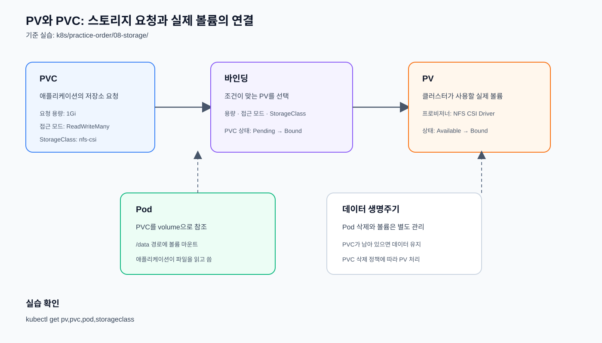

# Persistent Storage

Stateful 애플리케이션의 데이터를 Pod 생명주기와 분리한다.

> 사전 확인: 이 실습은 NFS Server Pod 이미지를 사용하므로 먼저
> [클러스터 이미지 아키텍처 점검](../../operations/01-cluster/README.md#이미지-아키텍처-사전-점검)을
> 실행한다. `andrewkidd/nfs-server:v2.2.7`은 ARM64·AMD64를 지원하지만,
> 노드 커널의 `nfs`·`nfsd` 모듈이 필요하다.

PV와 PVC의 역할과 연결 흐름은 다음 SVG에서 확인한다.



## NFS Pod 기반 CSI 실습

이 실습은 외부 NFS 서버 대신 테스트용 `nfs-server` Pod를 사용한다. NFS CSI
Driver가 이미 설치되어 있어야 하며, NFS Server Pod가 배치될 모든 노드에
`nfs`·`nfsd` 커널 모듈이 로드되어 있어야 한다.

### 1. NFS CSI Driver 확인

공식 CSI Driver 설치 방법은
[NFS CSI 설치 문서][nfs-csi-install]를
따른다.

[nfs-csi-install]: https://github.com/kubernetes-csi/csi-driver-nfs/blob/master/docs/install-csi-driver-v4.13.4.md

```bash
kubectl -n kube-system get pod -l app=csi-nfs-controller
```

NFS CSI Controller Pod의 상태를 확인한다.

```bash
kubectl -n kube-system get pod -l app=csi-nfs-node
```

각 노드에서 실행되는 NFS CSI Node Pod의 상태를 확인한다.

```bash
kubectl get csidriver nfs.csi.k8s.io
```

NFS CSI Driver가 Kubernetes에 등록되었는지 확인한다.

### 2. NFS Server Pod와 PVC 실행

```bash
kubectl apply -f nfs-kernel-modules.yml
```

각 노드에서 NFS 커널 모듈을 준비하는 DaemonSet을 생성한다.

```bash
kubectl rollout status daemonset/nfs-kernel-modules
```

모든 대상 노드에서 커널 모듈 준비가 완료될 때까지 기다린다.

```bash
kubectl apply -f nfs-pod.yml
```

테스트용 NFS Server Pod를 생성한다.

```bash
kubectl apply -f nfs-service.yml
```

NFS Server Pod에 접근할 ClusterIP Service를 생성한다.

```bash
kubectl apply -f nfs-storageclass.yml
```

NFS CSI 동적 프로비저닝용 StorageClass를 생성한다.

```bash
kubectl apply -f nfs-pvc.yml
```

NFS 저장소를 요청하는 PVC를 생성한다.

```bash
kubectl apply -f nfs-test-pod.yml
```

PVC를 마운트하는 테스트 Pod를 생성한다.

상태 확인:

```bash
kubectl get pod nfs-server nfs-pvc-test -o wide
```

NFS Server와 PVC 테스트 Pod의 상태와 배치 노드를 확인한다.

```bash
kubectl get daemonset nfs-kernel-modules
```

NFS 커널 모듈 DaemonSet의 desired/current/ready 수를 확인한다.

```bash
kubectl get service nfs-server
```

NFS Server Service의 ClusterIP와 포트를 확인한다.

```bash
kubectl get storageclass nfs-csi
```

NFS CSI StorageClass가 생성되었는지 확인한다.

```bash
kubectl get pvc nfs-test-pvc
```

PVC가 `Bound` 상태인지 확인한다.

PVC가 `Bound`가 되면 테스트 Pod에서 파일을 확인한다.

```bash
kubectl exec nfs-pvc-test -- cat /data/hello.txt
```

PVC에 기록된 파일을 테스트 Pod에서 읽어 실제 마운트를 검증한다.

### 3. 실습 종료

```bash
kubectl delete -f nfs-test-pod.yml
```

PVC를 사용하는 테스트 Pod를 삭제한다.

```bash
kubectl delete -f nfs-pvc.yml
```

테스트 PVC를 삭제한다.

```bash
kubectl delete -f nfs-storageclass.yml
```

NFS CSI StorageClass를 삭제한다.

```bash
kubectl delete -f nfs-service.yml
```

NFS Server Service를 삭제한다.

```bash
kubectl delete -f nfs-pod.yml
```

NFS Server Pod를 삭제한다.

```bash
kubectl delete -f nfs-kernel-modules.yml
```

NFS 커널 모듈 준비 DaemonSet을 삭제한다.

`nfs-server` Pod는 `hostPath`와 `privileged` 권한을 사용하므로 실습용 구성이다.
서버 Pod가 실행되는 노드와 노드 커널에 종속되며 고가용성을 제공하지 않는다.

- [`persistentvolume/`](./persistentvolume/): 실제 저장소 자원
- [`persistentvolumeclaim/`](./persistentvolumeclaim/): 애플리케이션의 저장소 요청
- [`storageclass/`](./storageclass/): 동적 볼륨 프로비저닝 정책

MariaDB StatefulSet의 `volumeClaimTemplates`는 이 개념을 Pod별 PVC 생성에
적용한 예제다. 현재 StatefulSet은 `nfs-csi` StorageClass를 사용한다.
