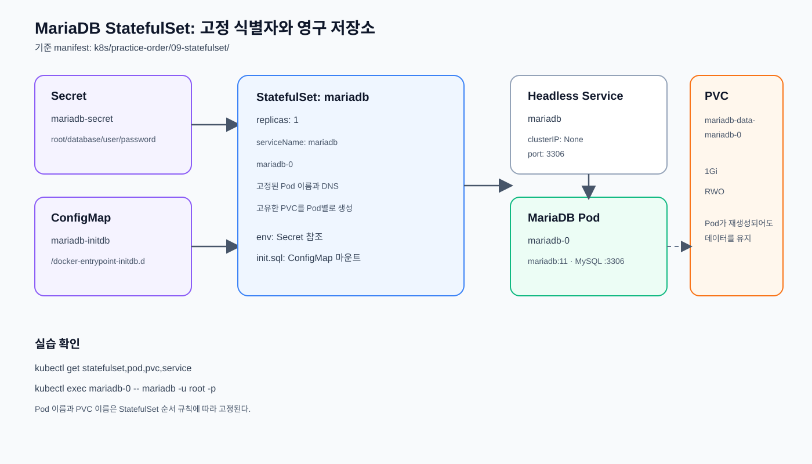

# StatefulSet

고유한 네트워크 식별자와 지속적인 스토리지가 필요한
애플리케이션을 관리한다.

## MariaDB StatefulSet 실습

[`statefulset.yml`](./statefulset.yml)은 MariaDB 1개를 StatefulSet으로 실행하는
학습용 구성이다.

적용 전에 [`08-storage`](../08-storage/README.md)의 NFS CSI Driver 설치와
`nfs-csi` StorageClass 준비를 완료한다. StatefulSet의
`volumeClaimTemplates`가 이 StorageClass를 사용해 전용 PVC를 생성한다.

- `Secret`: MariaDB 초기화용 비밀번호와 데이터베이스 정보 제공
- `ConfigMap`: 최초 초기화 시 실행할 `init.sql` 제공
- Headless Service: `mariadb-0.mariadb` 형태의 고정 DNS 제공
- `volumeClaimTemplates`: `mariadb-0` 전용 PVC 자동 생성

### Headless Service를 사용하는 이유

현재 MariaDB StatefulSet은 `replicas: 1`이므로 실행 중인 Pod는 `mariadb-0` 하나다.
따라서 지금 당장 여러 Pod를 분산하기 위한 목적은 아니다. 다만 StatefulSet은
Pod에 순서가 있는 고정 이름과 네트워크 식별자를 부여하므로, 단일 Pod라도
`mariadb-0.mariadb`라는 안정적인 DNS 이름으로 접근할 수 있게 Headless Service를
사용한다.

`clusterIP: None`인 `mariadb` Service는 가상 IP 하나로 요청을 분산하는 대신
StatefulSet Pod의 DNS 레코드와 Endpoint를 제공한다.

- 현재는 `mariadb-0.mariadb`로 단일 Pod를 안정적으로 식별한다.
- replicas를 늘리면 `mariadb-1.mariadb`, `mariadb-2.mariadb`처럼 같은 규칙으로
  각 Pod를 식별할 수 있다.
- Pod가 재생성되어 IP가 바뀌어도 애플리케이션이 동일한
  DNS 이름을 사용할 수 있다.
- 데이터베이스 복제나 클러스터링에서 구성원별 연결 대상을
  구분할 수 있다.
- 클라이언트가 여러 Pod 주소를 확인해 자체 연결 선택·부하분산을
  수행할 수 있다.

즉, 현재 실습에서는 단일 MariaDB Pod의 고정 식별과 서비스 디스커버리에 초점을
두며, 향후 replicas 증가에도 사용할 수 있는 네트워크 규칙을 미리 연습한다.

### StatefulSet과 Deployment 비교

StatefulSet의 정확한 반대 리소스가 따로 있는 것은 아니다. 일반적으로 상태가
필요한 워크로드는 StatefulSet, 상태를 Pod 외부에 저장하지 않는 무상태 워크로드는
Deployment로 관리한다.

| 구분 | StatefulSet | Deployment |
| --- | --- | --- |
| 대상 | 상태 저장 애플리케이션 | 무상태 애플리케이션 |
| Pod 이름 | `mariadb-0`처럼 고정 | 재생성 시 변경될 수 있음 |
| 생성·삭제 순서 | 순서 보장 | 순서 보장 없음 |
| 저장소 | Pod별 PVC 연결 | 임시 저장소 또는 별도 공유 저장소 |
| 대표 예시 | MariaDB, Redis, Kafka | Nginx, FastAPI, Frontend |

판단 기준은 “Pod가 재생성되어도 같은 정체성과 데이터를 유지해야 하는가”이다.
그렇다면 StatefulSet을 선택하고, 어느 Pod가 처리하든 결과가 같으며 데이터가
외부 시스템에 저장된다면 Deployment를 선택한다.

### `replicas: 1`에서의 장점과 한계

**장점**

- Pod가 재생성되어 IP가 변경되어도 `mariadb-0.mariadb`로 계속 접근할 수 있다.
- 애플리케이션 설정에 Pod IP를 직접 기록하지 않아도 된다.
- replicas를 늘릴 때도 동일한 DNS와 식별 규칙을 사용할 수 있다.

**한계**

- Headless Service만으로 고가용성이 만들어지지는 않는다.
- MariaDB 데이터 복제나 장애 Pod 자동 전환을 제공하지 않는다.
- 현재 구성은 단일 인스턴스이므로 부하분산과 무중단 장애 대응 대상이 아니다.

구조:



구성 파일:

1. [`../07-secret/secret.yml`](../07-secret/secret.yml): MariaDB 인증정보
2. [`../06-configmap/configmap.yml`](../06-configmap/configmap.yml): 최초 실행 SQL
3. [`../05-service/service.yml`](../05-service/service.yml): Headless Service
4. [`statefulset.yml`](./statefulset.yml): MariaDB StatefulSet (`nfs-csi` PVC)

스토리지 선행 실습:
[`../08-storage/README.md`](../08-storage/README.md)

### 실행 및 확인

```bash
kubectl apply -f ../07-secret/secret.yml
```

MariaDB 인증정보 Secret을 생성한다.

```bash
kubectl apply -f ../06-configmap/configmap.yml
```

MariaDB 최초 초기화 SQL ConfigMap을 생성한다.

```bash
kubectl apply -f ../05-service/service.yml
```

MariaDB Headless Service를 생성한다.

```bash
kubectl apply -f statefulset.yml
```

MariaDB StatefulSet과 `volumeClaimTemplates`를 생성한다.

```bash
kubectl rollout status statefulset/mariadb
```

MariaDB StatefulSet의 Pod가 Ready 상태가 될 때까지 기다린다.

```bash
kubectl get statefulset mariadb
```

StatefulSet의 replica와 ready replica 수를 확인한다.

```bash
kubectl get pod mariadb-0 -o wide
```

고정 이름 `mariadb-0` Pod의 상태와 배치된 노드를 확인한다.

```bash
kubectl get pvc
```

StatefulSet이 생성한 PVC가 `Bound` 상태인지 확인한다.

```bash
kubectl get service mariadb
```

Headless Service의 `CLUSTER-IP`가 `None`인지 확인한다.

MariaDB 접속 테스트:

```bash
kubectl exec -it mariadb-0 -- mariadb -u root -prootpass -e "SHOW DATABASES;"
```

root 계정으로 MariaDB 데이터베이스 목록을 확인한다.

```bash
kubectl exec -it mariadb-0 -- mariadb -u fcgiuser -pfcgipass fcgidb -e "SHOW TABLES;"
```

애플리케이션 계정으로 `fcgidb`의 테이블 목록을 확인한다.

StatefulSet Pod의 고정 DNS 확인:

```bash
kubectl run dns-test --rm -it --restart=Never --image=busybox:1.36 -- nslookup mariadb-0.mariadb
```

임시 DNS 테스트 Pod에서 StatefulSet Pod의 고정 DNS 이름을 조회한다.

### 삭제

StatefulSet과 함께 생성된 PVC는 데이터 보존을 위해 자동 삭제되지 않는다.

```bash
kubectl delete -f statefulset.yml
```

MariaDB StatefulSet을 삭제한다.

```bash
kubectl delete -f ../05-service/service.yml
```

MariaDB Headless Service를 삭제한다.

```bash
kubectl delete -f ../06-configmap/configmap.yml
```

MariaDB 초기화 SQL ConfigMap을 삭제한다.

```bash
kubectl delete -f ../07-secret/secret.yml
```

MariaDB 인증정보 Secret을 삭제한다.

```bash
kubectl get pvc
```

StatefulSet 삭제 후에도 남아 있는 PVC를 확인한다.

실습 데이터를 완전히 삭제할 때만 다음 명령을 실행한다.

```bash
kubectl delete pvc mariadb-data-mariadb-0
```

> `k8s/examples/1/db.yml`의 Deployment 방식과 동시에 적용하지 않는다. 두 구성은
> 같은 `mariadb` 리소스 이름을 사용한다.
