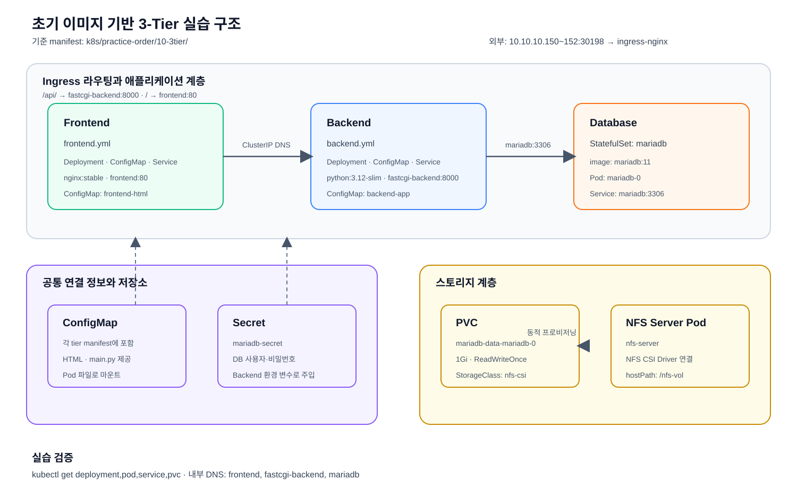

# 3-Tier 애플리케이션

초기 이미지와 앞 단계의 ConfigMap·Secret을 연결해 3-Tier 구조를 구성한다.
Database는 09번 StatefulSet 구성을 적용해 `nfs-csi` PVC에 저장한다.

> 이 단계만으로는 외부에서 접속할 수 있는 완성된 서비스가 아니다. Frontend·Backend·Database와
> 내부 Service를 구성하는 단계이며, 외부 HTTP 접근과 경로 라우팅은 다음 11번
> [Ingress 실습](../11-ingress/README.md)을 적용해야 사용할 수 있다.

이 실습은 애플리케이션을 미리 포함한 통합 이미지가 아니라 기본 런타임 이미지에
ConfigMap의 코드와 파일을 주입해 실행한다.

| 계층 | 이미지 | Kubernetes Service |
| --- | --- | --- |
| Frontend | `nginx:stable` + HTML ConfigMap | `frontend:80` |
| Backend | `python:3.12-slim` + `main.py` ConfigMap | `fastcgi-backend:8000` |
| Database | `mariadb:11` + StatefulSet·PVC | `mariadb:3306` |

- [3-Tier Database manifest](./database.yml)

Backend 컨테이너는 시작할 때 실습에 필요한 `fastapi`, `uvicorn`, `pymysql`,
`python-multipart` 패키지를 설치한 뒤 ConfigMap의 `main.py`를 실행한다.
따라서 인터넷이 연결된 클러스터에서 실행해야 하며, 운영 환경에서는 별도의
의존성 이미지 또는 패키지 캐시를 사용한다.

`database.yml`은 MariaDB StatefulSet, `nfs-csi` PVC, Headless Service를 제공한다.
따라서 08번 NFS CSI 실습과 `nfs-server`가 먼저 준비되어 있어야 한다. MariaDB
Pod는 `mariadb-0`이라는 고정 이름을 사용하고, 데이터는
`mariadb-data-mariadb-0` PVC에 저장된다. 외부 노출은 다음 11단계 Ingress 실습에서
구성한다.

## 실습 구조



현재 단계의 통신 범위는 다음과 같다.

```text
Frontend Pod ── frontend Service ──┐
                                   ├── 클러스터 내부 통신
Backend Pod  ── fastcgi-backend ───┤
                                   └── mariadb Service ── MariaDB Pod

외부 브라우저 ──(아직 연결되지 않음)──> Ingress
```

외부 브라우저에서 접속하려면 11번에서 `IngressClass/nginx`와 Ingress
Controller를 준비하고 `fastapi-ingress` 리소스를 적용해야 한다.

## 사전 조건

다음 리소스가 먼저 준비되어 있어야 한다.

1. `mariadb-secret`: MariaDB 인증정보
2. `mariadb-initdb`: 초기화 SQL ConfigMap
3. `nfs-csi`: NFS CSI StorageClass와 실행 중인 NFS Server

애플리케이션 Secret은 [`07-secret`](../07-secret/README.md), 초기화 SQL은
[`06-configmap`](../06-configmap/README.md)에서 만든다. Frontend와 Backend
ConfigMap은 각 계층 manifest에 포함되어 있다.

09번에서 만든 공통 리소스를 아직 만들지 않았다면 먼저 각각 적용한다.

```bash
kubectl apply -f ../07-secret/secret.yml
```

MariaDB 인증정보 Secret을 생성한다.

```bash
kubectl apply -f ../06-configmap/configmap.yml
```

MariaDB 초기화 SQL ConfigMap을 생성한다.

08번 NFS CSI 실습에서 `nfs-csi` StorageClass와 `nfs-server`가 실행 중인지
확인한다. 이 3-Tier 구성은 `emptyDir`로 대체하지 않는다.

```bash
kubectl get storageclass nfs-csi
```

MariaDB PVC가 사용할 `nfs-csi` StorageClass가 존재하는지 확인한다.

```bash
kubectl get pod nfs-server
```

NFS Server Pod가 실행 중인지 확인한다. 이 Pod가 없으면 StatefulSet의 PVC가
`Pending` 상태로 남을 수 있다.

## 적용

기존 10번 구성에서 `mariadb` Deployment와 ClusterIP Service가 이미 실행 중이면
새 StatefulSet·Headless Service와 이름이 충돌할 수 있다. 먼저 기존 상태를 확인하고,
실습 데이터가 필요하면 백업한 뒤 기존 DB 구성을 정리하고 적용한다. 새 구성은
`mariadb-0`과 `mariadb-data-mariadb-0` PVC를 사용한다.

```bash
kubectl get deployment mariadb
```

기존 MariaDB Deployment가 있는지 확인한다.

```bash
kubectl get service mariadb
```

기존 MariaDB Service의 타입을 확인한다. 기존 Service가 ClusterIP이면 Headless
Service로 자동 전환되지 않으므로 별도 정리가 필요하다.

```bash
kubectl apply -f database.yml
```

MariaDB StatefulSet, PVC, Headless Service를 생성한다.

```bash
kubectl apply -f frontend.yml
```

Frontend Deployment, ConfigMap, Service를 생성한다.

```bash
kubectl apply -f backend.yml
```

Backend Deployment, ConfigMap, Service를 생성한다.

상태와 내부 Service를 확인한다.

```bash
kubectl get deployment,pod,service -l app=frontend
```

Frontend 리소스 상태를 확인한다.

```bash
kubectl get deployment,pod,service -l app=fastcgi-backend
```

Backend 리소스 상태를 확인한다.

```bash
kubectl get service frontend fastcgi-backend mariadb
```

3개 계층의 Service가 생성되었는지 확인한다.

MariaDB StatefulSet과 Pod 상태는 다음 명령으로 확인한다.

```bash
kubectl get statefulset,pod,pvc -l app=mariadb
```

`mariadb-0`이 `Running`, PVC가 `Bound`인지 확인한다.

Backend Pod에서 MariaDB Service DNS로 연결되는지 확인한다.

```bash
kubectl exec deploy/fastcgi-backend -- \
  python -c 'import socket; print(socket.gethostbyname("mariadb"))'
```

Frontend와 Backend의 ClusterIP는 다음 명령으로 확인한다.

```bash
kubectl get service frontend fastcgi-backend mariadb -o wide
```

이 단계에서는 ClusterIP를 이용한 클러스터 내부 연결만 확인한다. NodePort 주소나
브라우저를 통한 외부 접근은 11번 Ingress 실습을 완료한 뒤 확인한다.

## 삭제

```bash
kubectl delete -f backend.yml
```

Backend 리소스를 삭제한다.

```bash
kubectl delete -f frontend.yml
```

Frontend 리소스를 삭제한다.

```bash
kubectl delete -f database.yml
```

테스트용 MariaDB 리소스를 삭제한다.

`database.yml`을 삭제해도 StatefulSet이 생성한 PVC는 데이터 보존을 위해 남는다.
데이터까지 삭제하려면 StatefulSet Pod와 연결된 PVC를 별도로 삭제한다.

```bash
kubectl delete pvc mariadb-data-mariadb-0
```

이 명령은 MariaDB 영속 데이터를 삭제한다.

## 원본 예제와의 관계

[`k8s/examples/1/frontend.yml`](../../examples/1/frontend.yml)과
[`k8s/examples/1/backend.yml`](../../examples/1/backend.yml)의 Deployment·Service
구조를 기준으로 한다. Backend와 Frontend는 각각의 실습 manifest에 Deployment,
ConfigMap, Service를 모두 포함한다. 외부 경로 라우팅은
[`11-ingress`](../11-ingress/README.md)에서 관리한다.
Backend는 이 실습의
[`backend.yml`](./backend.yml)에 Deployment, ConfigMap, Service를 모두 포함한다.
Frontend도 [`frontend.yml`](./frontend.yml)에 Deployment, ConfigMap, Service를
모두 포함한다.

ConfigMap 생성만 별도로 연습하려면
[`06-configmap/frontend.yml`](../06-configmap/frontend.yml) 또는
[`06-configmap/backend.yml`](../06-configmap/backend.yml)을 사용한다. 단, 3-Tier
실습에서는 같은 이름의 ConfigMap을 중복 적용하지 않는다.

## Chapter 2 확장 예제

기존 3-Tier를 기준으로 다음 단계의 고급 실습을 이어서 적용할 수 있다.

- [Security RBAC](../14-security/3tier-backend-rbac.yml): Backend ServiceAccount와 권한
- [MariaDB 백업 CronJob](../15-batch/3tier-mariadb-backup.yml): NFS PVC에 데이터 백업
- [ResourceQuota·LimitRange](../17-cluster-scoped/3tier-limits.yml): Namespace 자원 제한
- [Custom Resource](../18-extension/3tier-backup-cr.yml): 3-Tier 백업 정책 API 모델
