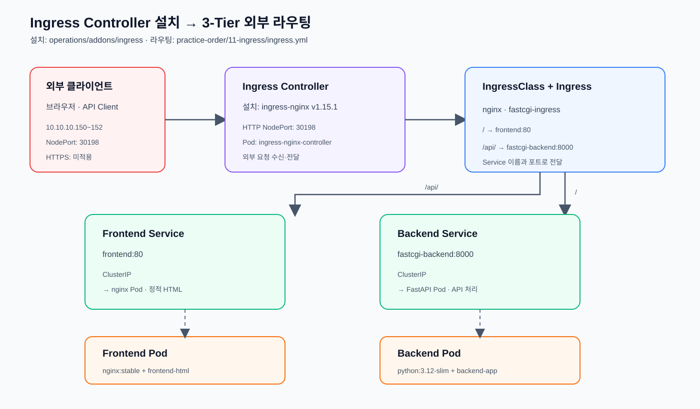

# Ingress

클러스터 외부 요청을 HTTP 경로에 따라 내부 Service로 전달한다.

이 실습은 [10-3tier](../10-3tier/README.md)에서 실행한 기존
`frontend`와 `fastcgi-backend` Service를 외부에 노출하는 단계다.



## Ingress Controller 확인

Ingress 리소스를 적용하기 전에 `ingress-nginx` Controller와 `nginx`
IngressClass가 설치되어 있는지 확인한다.

```bash
kubectl -n ingress-nginx get pods \
  -l app.kubernetes.io/component=controller
kubectl get ingressclass nginx
kubectl -n ingress-nginx get svc ingress-nginx-controller
```

현재 실습 클러스터의 Controller Service는 다음 NodePort를 사용한다.

```text
HTTP 80:30198/TCP
HTTPS 443:31476/TCP
```

## 3-Tier용 Ingress 적용

10단계에서 생성한 `frontend`와 `fastcgi-backend` Service를 기준으로 경로를
라우팅한다.

```bash
kubectl apply -f ingress.yml
kubectl get ingress fastcgi-ingress
kubectl describe ingress fastcgi-ingress
```

라우팅:

- `/` → `frontend:80`
- `/api/` → `fastcgi-backend:8000`

10단계 3-Tier 리소스가 실행된 뒤 다음 주소로 외부 접근한다.

```text
http://10.10.10.150:30198/
http://10.10.10.151:30198/
http://10.10.10.152:30198/
```

> Ingress는 대상 Service가 먼저 존재해야 실제 라우팅할 수 있다. 10단계에서
> Frontend·Backend Service를 먼저 생성한 뒤 11단계에서 적용한다.

## 삭제

```bash
kubectl delete -f ingress.yml
```
