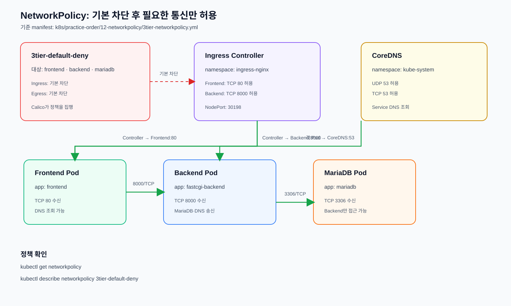

# NetworkPolicy

Pod 간 ingress·egress 네트워크 허용 규칙을 정의한다. CNI가 NetworkPolicy를
지원해야 실제로 적용된다.



현재 클러스터는 Calico CNI를 사용하므로 Kubernetes 표준 NetworkPolicy를
적용한다. NetworkPolicy의 목적은 3-Tier 구성 요소 사이의 통신을 보호하고
허용된 경로만 명시적으로 관리하는 것이다. 정책에 포함되지 않은 통신은
제한된다.

정책 대상은 기존 10단계 3-Tier의 `frontend`, `fastcgi-backend`, `mariadb`
Pod이며, 별도의 애플리케이션을 생성하지 않는다.

## 3-Tier 정책

[`3tier-networkpolicy.yml`](./3tier-networkpolicy.yml)은 다음 보호 경로를
명시한다.

```text
Ingress Controller → Frontend:80
Frontend → Backend:8000
Backend → MariaDB:3306
Frontend·Backend → kube-dns:53
Backup Job → MariaDB:3306
Operational Backend → 외부 HTTPS:443 및 kube-dns:53
```

13번 `backend-operational.yml`은 시작할 때 PyPI에서 패키지를 설치하므로
실습용으로 외부 HTTPS egress를 허용한다. 운영 환경에서는 의존성을 이미지에
미리 포함하고 이 예외를 제거하는 편이 안전하다.

15번 Backup Job은 `app: mariadb-backup` 라벨을 사용하며, MariaDB로의 덤프
통신만 허용한다.

정책 대상은 `app` 라벨이 `frontend`, `fastcgi-backend`, `mariadb`인 Pod다.

## 적용 순서

10단계 3-Tier와 11단계 Ingress가 정상 동작하는지 먼저 확인한 뒤 적용한다.

```bash
kubectl apply -f 3tier-networkpolicy.yml
kubectl get networkpolicy
kubectl describe networkpolicy 3tier-default-deny
```

정책 적용 후에도 외부 접근이 되는지 확인한다.

```bash
curl http://10.10.10.150:30198/
kubectl get pods -l app=frontend
kubectl get pods -l app=fastcgi-backend
kubectl get pods -l app=mariadb
```

정책이 적용된 뒤 예상한 통신이 제한되면 다음 항목을 확인한다.

- `ingress-nginx` Namespace에 `kubernetes.io/metadata.name` 라벨이 있는지
- CoreDNS Pod에 `k8s-app: kube-dns` 라벨이 있는지
- Frontend·Backend·MariaDB Pod의 `app` 라벨이 정책과 일치하는지
- Calico Node와 Typha Pod가 정상인지

```bash
kubectl get namespace ingress-nginx kube-system --show-labels
kubectl -n kube-system get pods -l k8s-app=kube-dns
kubectl -n calico-system get pods
```

## 삭제

```bash
kubectl delete -f 3tier-networkpolicy.yml
```
