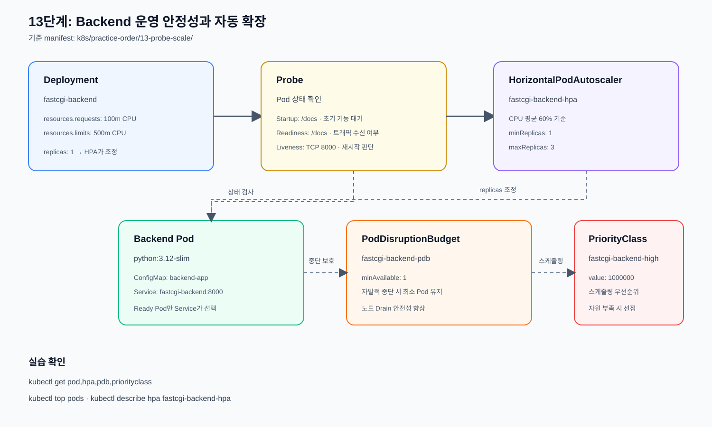

# 자동 확장 오브젝트

## 사전 조건

HPA가 사용할 Metrics Server는 운영 영역에서 먼저 설치·확인한다.

- [Metrics Server 운영 자료](../../operations/07-addons/autoscaling/README.md)

Metrics Server가 준비되지 않으면 Probe 실습은 진행할 수 있지만 HPA 적용은
보류한다. 설치와 장애 확인은 이 실습 문서가 아니라 운영 자료에서 수행한다.

기존 10단계 3-Tier Backend를 기준으로 Probe, 수동 Scale, HPA, PDB,
PriorityClass를 적용한다.



## 예제 파일

- [`backend-operational.yml`](./backend-operational.yml): Probe·리소스·우선순위를
  포함한 Backend Deployment
- [`horizontalpodautoscaler/backend-hpa.yml`](./horizontalpodautoscaler/backend-hpa.yml): CPU 기반 자동 확장
- [`poddisruptionbudget/backend-pdb.yml`](./poddisruptionbudget/backend-pdb.yml): 자발적 중단 보호
- [`priorityclass/fastcgi-backend-priority.yml`](./priorityclass/fastcgi-backend-priority.yml): 스케줄링 우선순위

## 적용 순서

먼저 10단계 3-Tier의 ConfigMap, Secret, Service가 준비되어 있어야 한다.

```bash
kubectl apply -f ../10-3tier/backend.yml
```

기존 3-Tier Backend Deployment와 Service를 준비한다.

```bash
kubectl apply -f priorityclass/fastcgi-backend-priority.yml
```

Backend Pod가 사용할 PriorityClass를 생성한다.

```bash
kubectl apply -f backend-operational.yml
```

Probe와 리소스 요청량이 포함된 운영형 Backend Deployment를 적용한다.

```bash
kubectl apply -f poddisruptionbudget/backend-pdb.yml
```

Backend의 자발적 중단 시 유지할 최소 Pod 수를 정의한다.

`backend-operational.yml`은 기존 `fastcgi-backend` Deployment를 Probe와
PriorityClass가 포함된 운영형 예제로 갱신한다.

## 수동 Scale

```bash
kubectl scale deployment fastcgi-backend --replicas=2
```

Backend Deployment의 원하는 Pod 수를 2개로 변경한다.

```bash
kubectl get deployment,pod -l app=fastcgi-backend
```

Deployment의 replica 수와 실제 Backend Pod 수가 2개로 조정되었는지 확인한다.

```bash
kubectl scale deployment fastcgi-backend --replicas=1
```

수동 확장 실습을 끝내고 Backend Pod 수를 1개로 되돌린다.

## HPA 적용

Metrics Server가 동작해야 한다.

```bash
kubectl top pods
```

Backend Pod의 현재 CPU·메모리 사용량을 확인한다. 이 명령이 실패하거나
`unknown`이 표시되면 Metrics Server를 먼저 점검한다.

```bash
kubectl apply -f horizontalpodautoscaler/backend-hpa.yml
```

Backend Deployment를 대상으로 하는 HPA를 생성한다.

```bash
kubectl get hpa fastcgi-backend-hpa
```

HPA의 최소·최대 replica와 현재 replica, 현재 CPU 사용률을 요약해 확인한다.

```bash
kubectl describe hpa fastcgi-backend-hpa
```

HPA의 대상 Deployment, metric 수집 상태, 확장 조건과 이벤트를 상세 확인한다.

## 확인 및 삭제

```bash
kubectl get pod -l app=fastcgi-backend
```

Backend 애플리케이션 Pod의 Ready 상태와 재시작 횟수를 확인한다.

```bash
kubectl describe pod -l app=fastcgi-backend
```

Backend Pod의 Probe 결과, 이벤트, 리소스 요청량과 PriorityClass 적용 여부를
상세 확인한다.

```bash
kubectl get pdb fastcgi-backend-pdb
```

PodDisruptionBudget의 최소 가용 Pod 수와 현재 허용 중단 수를 확인한다.

```bash
kubectl get priorityclass fastcgi-backend-high
```

Backend가 참조하는 PriorityClass의 우선순위 값과 전역 기본값 여부를 확인한다.

```bash
kubectl delete -f horizontalpodautoscaler/backend-hpa.yml
```

Backend HPA를 삭제한다.

```bash
kubectl delete -f poddisruptionbudget/backend-pdb.yml
```

Backend PodDisruptionBudget을 삭제한다.

```bash
kubectl delete -f backend-operational.yml
```

운영형 Backend Deployment를 삭제한다.

```bash
kubectl delete -f priorityclass/fastcgi-backend-priority.yml
```

Backend용 PriorityClass를 삭제한다.
