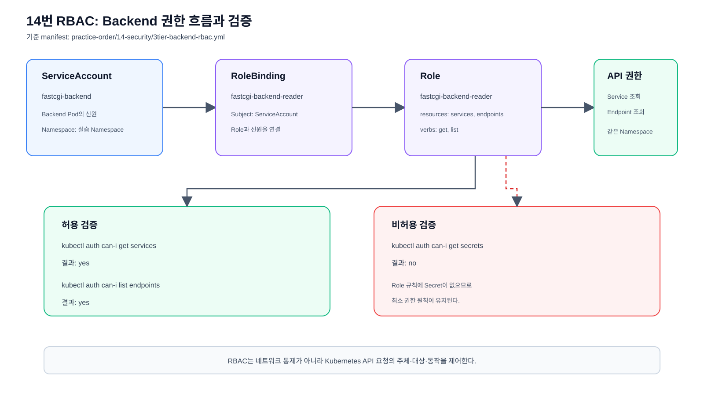

# 보안 오브젝트

서비스 계정과 RBAC 권한을 관리한다.



## 기존 3-Tier Backend 예제

[`3tier-backend-rbac.yml`](./3tier-backend-rbac.yml)은 Backend가 같은 Namespace의
Service와 Endpoint를 조회할 수 있는 ServiceAccount·Role·RoleBinding을 구성한다.

```bash
kubectl apply -f 3tier-backend-rbac.yml
```

Backend용 ServiceAccount, Role, RoleBinding을 생성한다.

```bash
kubectl get serviceaccount fastcgi-backend
```

ServiceAccount가 생성되었는지 확인한다.

```bash
kubectl get role fastcgi-backend-reader
```

Role의 존재 여부를 확인한다.

```bash
kubectl get rolebinding fastcgi-backend-reader
```

RoleBinding이 ServiceAccount와 Role을 연결했는지 확인한다.

## 상세 실습 검증

모든 명령은 저장소 루트인 `k8s` 디렉터리에서 실행한다. 기존 3-Tier와
분리된 Namespace에서 권한을 검증한다.

### 1. Namespace와 RBAC 리소스 생성

```bash
export KUBECONFIG=/Users/jarrod/.kube/k8s-config
export RBAC_NAMESPACE=k8s-rbac-practice
```

RBAC 실습에서 사용할 kubeconfig와 Namespace 이름을 설정한다.

```bash
kubectl create namespace "$RBAC_NAMESPACE"
```

권한 검증을 위한 별도 Namespace를 만든다.

```bash
kubectl apply \
  --namespace "$RBAC_NAMESPACE" \
  -f practice-order/14-security/3tier-backend-rbac.yml
```

검증 Namespace에 RBAC 리소스를 적용한다.

```bash
kubectl -n "$RBAC_NAMESPACE" get \
  serviceaccount/fastcgi-backend \
  role/fastcgi-backend-reader \
  rolebinding/fastcgi-backend-reader
```

생성된 세 가지 RBAC 리소스를 확인한다.

이미 Namespace가 있으면 `AlreadyExists`는 무시하고 다음 단계로 진행한다.

### 2. 허용 권한 검증

`--namespace`와 `--as`를 반드시 함께 지정한다.

```bash
kubectl auth can-i get services \
  --namespace "$RBAC_NAMESPACE" \
  --as="system:serviceaccount:${RBAC_NAMESPACE}:fastcgi-backend"
```

Backend ServiceAccount가 Service 조회 권한을 가지는지 확인한다. 예상 결과는
`yes`다.

```bash
kubectl auth can-i list endpoints \
  --namespace "$RBAC_NAMESPACE" \
  --as="system:serviceaccount:${RBAC_NAMESPACE}:fastcgi-backend"
```

Endpoint 목록 조회 권한도 `yes`여야 한다.

### 3. 비허용 권한 검증

Role에 Secret과 Pod 권한을 추가하지 않았으므로 모두 `no`여야 한다.

```bash
kubectl auth can-i get secrets \
  --namespace "$RBAC_NAMESPACE" \
  --as="system:serviceaccount:${RBAC_NAMESPACE}:fastcgi-backend"
```

Secret 조회 권한은 부여하지 않았으므로 예상 결과는 `no`다.

```bash
kubectl auth can-i get pods \
  --namespace "$RBAC_NAMESPACE" \
  --as="system:serviceaccount:${RBAC_NAMESPACE}:fastcgi-backend"
```

Pod 조회 권한도 부여하지 않았으므로 예상 결과는 `no`다.

### 4. 권한 규칙 상세 확인

```bash
kubectl -n "$RBAC_NAMESPACE" describe role fastcgi-backend-reader
```

Role에 정의된 API Group, Resource, Verb 규칙을 확인한다.

```bash
kubectl -n "$RBAC_NAMESPACE" describe rolebinding fastcgi-backend-reader
```

RoleBinding의 subject와 연결된 Role을 확인한다.

```bash
kubectl auth can-i --list \
  --namespace "$RBAC_NAMESPACE" \
  --as="system:serviceaccount:${RBAC_NAMESPACE}:fastcgi-backend"
```

`--list` 결과에서 `services`와 `endpoints`에 `get`, `list`만 허용되는지 확인한다.

### 5. 정리

```bash
kubectl delete namespace "$RBAC_NAMESPACE"
```

검증용 Namespace와 내부 RBAC 리소스를 삭제한다.

```bash
unset RBAC_NAMESPACE
```

현재 터미널의 검증용 환경변수를 제거한다.

현재 Backend 코드는 Kubernetes API를 직접 호출하지 않으므로, 실서비스에서는
필요한 권한만 부여하고 ServiceAccount 토큰 자동 마운트를 검토한다.
ServiceAccount를 Deployment에 연결하지 않으면 이 리소스는 권한 실습용으로만
존재하며, 기존 Backend Pod의 실행 권한은 변경되지 않는다.
