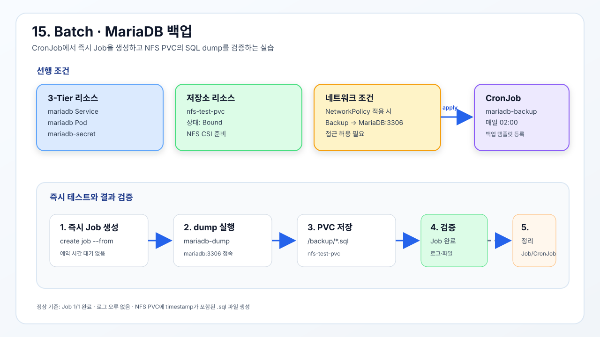

# Job

일회성 작업을 실행하고 지정된 성공 횟수를 만족하면 완료 상태로 유지한다.



## 기존 3-Tier MariaDB 백업

[`3tier-mariadb-backup.yml`](./3tier-mariadb-backup.yml)은 매일 02시에
`mariadb` Service로 접속해 `fcgidb`를 덤프하고 `nfs-test-pvc`에 저장한다.
Backup Pod에는 `app: mariadb-backup` 라벨을 부여하며, 12번 NetworkPolicy에서
MariaDB의 3306 포트 접근을 허용해야 Job이 완료된다.

## 사전 조건 확인

실제 백업을 실행하기 전에 다음 리소스가 준비되어 있어야 한다.

```bash
kubectl get service mariadb
```

Backup Pod가 접속할 MariaDB Service가 존재하는지 확인한다.

```bash
kubectl get pod -l app=mariadb
```

MariaDB Pod가 `Running`이고 `READY`가 `1/1`인지 확인한다.

```bash
kubectl get secret mariadb-secret
```

Backup 컨테이너가 사용할 `username`, `password`, `database` 키를 가진 Secret이
존재하는지 확인한다. Secret 값 자체는 출력하지 않는다.

```bash
kubectl get pvc nfs-test-pvc
```

백업 파일을 저장할 PVC가 `Bound` 상태인지 확인한다.

12번 NetworkPolicy를 적용한 경우에는 Backup Pod에서 MariaDB로의 3306 포트
접근이 허용되어 있어야 한다.

```bash
kubectl apply -f 3tier-mariadb-backup.yml
```

MariaDB 백업 CronJob을 생성한다.

```bash
kubectl get cronjob mariadb-backup
```

CronJob의 스케줄과 일시 중지 여부를 확인한다.

예약된 02시까지 기다리지 않고 테스트용 Job 이름을 만든다.

```bash
BACKUP_JOB="mariadb-backup-now-$(date +%s)"
```

현재 시각을 포함해 기존 Job과 이름이 충돌하지 않도록 한다.

```bash
kubectl create job --from=cronjob/mariadb-backup "$BACKUP_JOB"
```

예약 시간을 기다리지 않고 백업 Job을 즉시 생성한다.

```bash
kubectl wait --for=condition=complete "job/$BACKUP_JOB" --timeout=180s
```

Job이 성공적으로 완료될 때까지 최대 180초 기다린다. `condition=complete`가
성공해야 백업 명령이 정상 종료된 것이다.

```bash
kubectl get job "$BACKUP_JOB"
```

Job의 `COMPLETIONS`가 `1/1`인지 확인한다.

```bash
kubectl get pods -l app=mariadb-backup
```

Backup Job이 생성한 Pod의 완료·실행 상태를 확인한다.

```bash
kubectl logs "job/$BACKUP_JOB"
```

`mariadb-dump` 오류, DNS 오류, 인증 오류가 없는지 확인한다. 정상적인
`mariadb-dump`는 별도 출력 없이 종료될 수 있다.

## 백업 파일 확인

NFS PVC를 마운트한 테스트 Pod가 실행 중이어야 파일을 확인할 수 있다.

```bash
kubectl get pod nfs-pvc-test
```

PVC 확인용 Pod가 존재하는지 확인한다. 없다면 08번 Storage 실습의
`nfs-test-pod.yml`을 먼저 적용한다.

```bash
kubectl exec nfs-pvc-test -- sh -c 'ls -lh /data/*.sql'
```

NFS PVC에 생성된 MariaDB SQL dump 파일의 이름과 크기를 확인한다.

```bash
kubectl exec nfs-pvc-test -- sh -c 'head -20 /data/*.sql'
```

덤프 파일에 데이터베이스 구조와 테이블 생성 SQL이 포함되었는지 확인한다.

## 테스트 리소스 정리

```bash
kubectl delete job "$BACKUP_JOB"
```

즉시 실행한 테스트 Job과 완료된 Backup Pod를 삭제한다.

```bash
kubectl delete cronjob mariadb-backup
```

테스트가 끝난 뒤 백업 CronJob을 삭제한다. PVC와 백업 파일은 삭제하지 않는다.

> `nfs-test-pvc`가 먼저 Bound 상태여야 한다. 운영 환경에서는 백업 보존기간,
> 암호화, 외부 백업 저장소를 별도로 설계한다.
