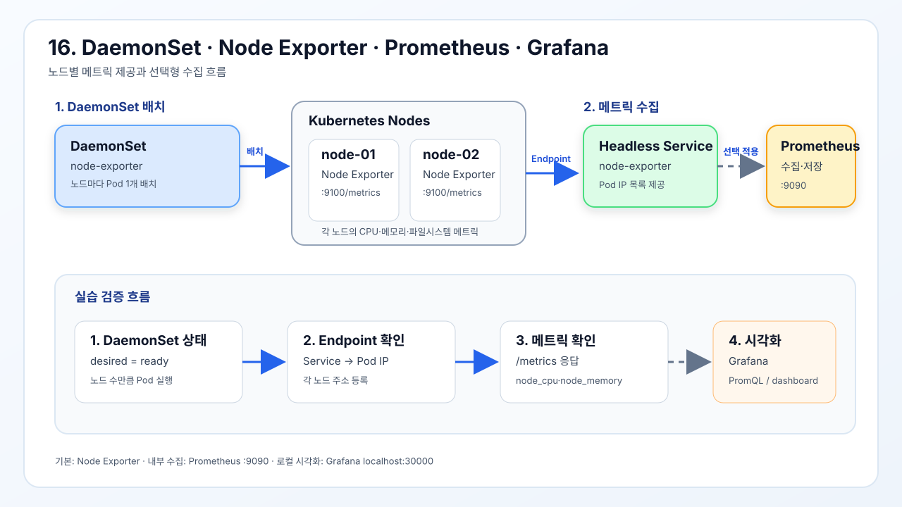

# DaemonSet

- [DaemonSet 실습 YAML](./daemonset.yml)
- [Node Exporter Service](./node-exporter-service.yml)
- [선택형 Prometheus YAML](./prometheus.yml)
- [Grafana 관리자 Secret](./grafana-secret.yml)
- [Grafana YAML](./grafana.yml)



모든 노드 또는 지정한 노드마다 Pod를 하나씩 실행한다.

이 실습에서는 웹서버 대신 각 노드의 메트릭을 제공하는 Node Exporter를
DaemonSet으로 실행한다. Prometheus는 Node Exporter의 메트릭을 수집하는 별도
Deployment이고 Grafana는 Prometheus 데이터를 시각화하는 별도 Deployment다.
Prometheus와 Grafana는 DaemonSet 학습 후 선택적으로 적용한다.

Node Exporter 이미지는 ARM64를 포함한 멀티 아키텍처 이미지를 사용한다. 호스트의
`/proc`, `/sys`, `/`를 읽기 전용으로 마운트하므로 테스트 클러스터에서만 사용한다.

## 1. Node Exporter DaemonSet

```bash
kubectl apply -f daemonset.yml
```

각 노드에 Node Exporter Pod를 하나씩 배치한다.

```bash
kubectl apply -f node-exporter-service.yml
```

각 Node Exporter Pod를 Prometheus가 검색할 Headless Service를 생성한다.

```bash
kubectl get daemonset node-exporter
```

DaemonSet의 desired/current/ready Pod 수를 확인한다. 세 노드 클러스터라면
정상적으로 3개의 Pod가 준비된다.

```bash
kubectl get pods -l app=node-exporter -o wide
```

노드별 Node Exporter Pod가 하나씩 실행되고 배치된 노드가 서로 다른지 확인한다.

```bash
kubectl get endpoints node-exporter
```

Headless Service에 각 Node Exporter Pod IP가 Endpoint로 등록되었는지 확인한다.

```bash
kubectl port-forward daemonset/node-exporter 9100:9100
```

Node Exporter의 메트릭 포트를 로컬 포트에 연결한다. 이 명령은 실행 중인
터미널을 점유하므로 다음 확인 명령은 별도 터미널에서 실행한다.

```bash
curl http://127.0.0.1:9100/metrics
```

`node_cpu`, `node_memory`, `node_filesystem`과 같은 노드 메트릭이 출력되는지
확인한다.

## 2. 선택형 Prometheus 수집

Prometheus는 DaemonSet이 아니다. 하나의 Deployment가 Headless Service의 모든
Node Exporter Endpoint를 DNS 기반으로 검색해 메트릭을 수집한다. 저장소는
`emptyDir`이므로 Pod가 재생성되면 수집 데이터가 삭제된다.

```bash
kubectl apply -f prometheus.yml
```

Prometheus ConfigMap, Deployment, Service를 생성한다.

```bash
kubectl get deployment prometheus
```

Prometheus Deployment가 `Available` 상태인지 확인한다.

```bash
kubectl logs deployment/prometheus --tail=50
```

Prometheus가 설정 파일을 읽고 Node Exporter를 검색하는지 확인한다.

```bash
kubectl port-forward service/prometheus 9090:9090
```

Prometheus 웹 UI를 로컬 포트에 연결한다.

```bash
curl http://127.0.0.1:9090/-/ready
```

Prometheus가 요청을 처리할 준비가 되었는지 확인한다. `Prometheus is Ready.`가
반환되어야 한다.

## 3. 선택형 Grafana 시각화

Grafana는 Prometheus를 데이터 소스로 사용해 Node Exporter 메트릭을 대시보드로
표시한다. Grafana는 16번에서 사용하는 Prometheus Service의 내부 DNS 이름인
`http://prometheus:9090`을 자동으로 데이터 소스로 등록한다.

이 실습은 로컬 시각화 확인이 목적이므로 Grafana 데이터는 `emptyDir`에 저장한다.
따라서 NFS CSI Driver 없이도 실행할 수 있으며, Grafana Pod가 재생성되면
대시보드와 설정이 초기화된다. 영속 저장소는 08번 Storage 실습 이후 별도로
추가한다.

```bash
kubectl apply -f grafana-secret.yml
```

Grafana 관리자 계정 Secret을 생성한다. 기본 비밀번호는 실습용이므로 운영
환경에서 반드시 변경한다.

```bash
kubectl apply -f grafana.yml
```

Prometheus 데이터소스 설정, Grafana Deployment와 내부 ClusterIP Service를 생성한다.

```bash
kubectl get deployment grafana
```

Grafana Deployment의 Available 상태를 확인한다.

```bash
kubectl logs deployment/grafana --tail=50
```

Grafana가 정상적으로 시작하고 데이터소스 설정을 읽었는지 확인한다.

```bash
kubectl get service grafana
```

Grafana Service가 `ClusterIP`이고 외부 NodePort가 없는지 확인한다.

Grafana는 외부에 노출하지 않고 Port Forward로 로컬에서만 확인한다.

```bash
kubectl port-forward service/grafana 30000:3000
```

Grafana Service의 내부 포트 `3000`을 관리 호스트의 `localhost:30000`으로
연결한다. 이 명령을 실행한 터미널은 유지한다.

별도 터미널에서 Grafana API 상태를 확인한다.

```bash
curl http://localhost:30000/api/health
```

응답의 `database`가 `ok`여야 한다.

브라우저에서는 다음 주소로 접속한다.

```text
http://localhost:30000
```

로그인 계정은 `grafana-secret.yml`의 `admin-user`와 `admin-password`를 사용한다.
Grafana 화면에서 `Connections → Data sources`에 Prometheus가 등록되어 있는지
확인하고, Explore 화면에서 다음 PromQL을 실행한다.

```text
up{job="node-exporter"}
```

Node Exporter Endpoint가 `1`로 표시되면 Prometheus와 Grafana 연결이 정상이다.

## 4. 정리

```bash
kubectl delete -f grafana.yml
```

Grafana Deployment, Service, ConfigMap을 삭제한다.

```bash
kubectl delete -f grafana-secret.yml
```

Grafana 관리자 Secret을 삭제한다.

```bash
kubectl delete -f prometheus.yml
```

선택형 Prometheus Deployment, Service, ConfigMap을 삭제한다.

```bash
kubectl delete -f node-exporter-service.yml
```

Node Exporter Headless Service를 삭제한다.

```bash
kubectl delete -f daemonset.yml
```

모든 노드의 Node Exporter Pod를 삭제한다.
