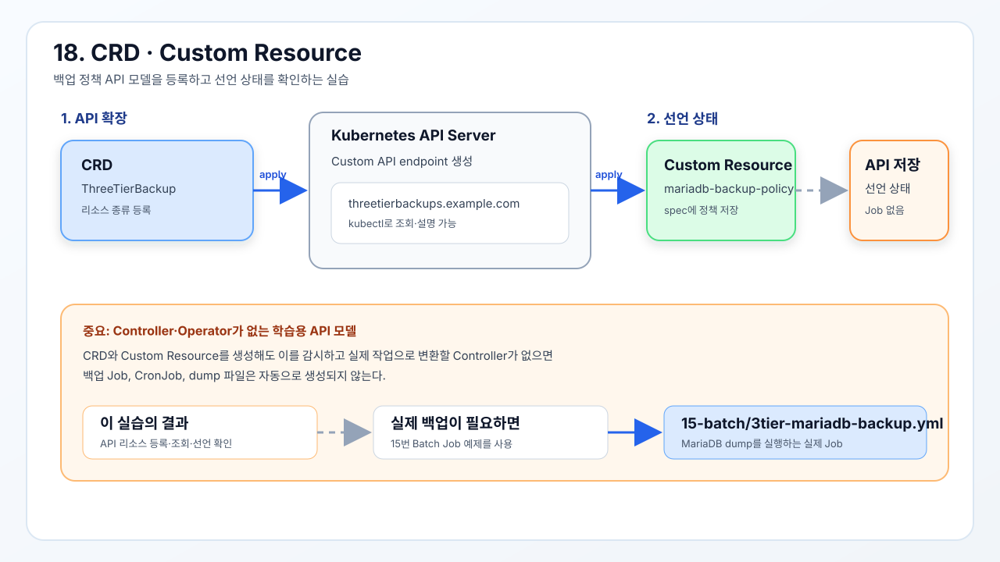

# 확장 오브젝트

CRD와 사용자 정의 리소스를 통해 Kubernetes API를 확장한다.



## 기존 3-Tier 백업 정책 모델

기존 3-Tier의 MariaDB 백업 요구사항을 사용자 정의 API로 표현한다.

- [`3tier-backup-crd.yml`](./3tier-backup-crd.yml): `ThreeTierBackup` 리소스 종류 등록
- [`3tier-backup-cr.yml`](./3tier-backup-cr.yml): MariaDB 백업 정책 인스턴스 생성

```bash
kubectl apply -f 3tier-backup-crd.yml
```

`ThreeTierBackup` Custom Resource를 인식할 CRD를 등록한다.

```bash
kubectl wait --for=condition=Established crd/threetierbackups.example.com
```

API Server가 CRD를 Established 상태로 등록할 때까지 기다린다.

```bash
kubectl apply -f 3tier-backup-cr.yml
```

MariaDB 백업 정책을 표현하는 Custom Resource 인스턴스를 생성한다.

```bash
kubectl get threetierbackup
```

생성된 `ThreeTierBackup` 리소스 목록과 상태를 확인한다.

```bash
kubectl describe threetierbackup mariadb-backup-policy
```

Custom Resource의 spec, status, 이벤트를 상세 확인한다.

이 예제는 CRD와 Custom Resource를 학습하기 위한 API 모델이다. Controller나
Operator가 포함되어 있지 않으므로 `ThreeTierBackup`을 생성해도 실제 백업 Job이
자동으로 실행되지는 않는다. 실제 백업은 15단계의
[`3tier-mariadb-backup.yml`](../15-batch/3tier-mariadb-backup.yml)을 사용한다.
