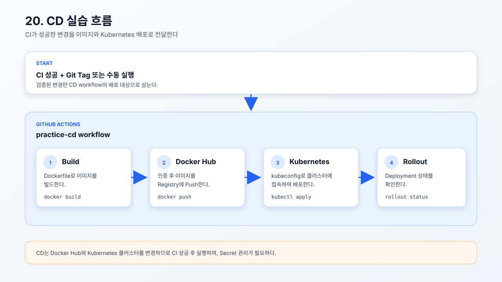

# 20. CD 배포

CD(Continuous Delivery/Deployment, 지속적 제공·배포)는 CI를 통과한 변경을
컨테이너 이미지로 만들고 대상 환경에 배포하는 과정이다.

- [실습용 CD workflow](./cd.yml)
- [CD 실습 흐름 SVG](./cd-overview.svg)



## CD란?

CI가 코드와 Manifest를 검사하는 단계라면, CD는 검증된 결과를 실제 실행 환경에
전달하는 단계다. 이 실습의 CD는 Docker Hub에 이미지를 Push한 뒤 kubeconfig로
Kubernetes 클러스터에 접속하여 Deployment를 갱신한다.

```text
CI 성공
   ↓
Git Tag 또는 수동 실행
   ↓
Docker 이미지 Build
   ↓
Docker Hub Push
   ↓
Kubernetes 배포
   ↓
Rollout 상태 확인
```

| 구분 | 역할 |
| --- | --- |
| CI | 코드와 Kubernetes Manifest를 검사한다. |
| CD | 이미지를 만들고 저장소에 Push한 뒤 클러스터에 배포한다. |

## 저장소 설정

19번에서 만든 `/Users/jarrod/project/code-test-check/k8s-EKS` 작업 디렉터리와
`ci-test` 저장소를 계속 사용한다. 기존 Kubernetes 저장소와 분리된 저장소의
`.github/workflows`에 CD workflow를 등록한다.

### 1. CD 파일 복사

19번에서 복사한 `ci-practice` 디렉터리 안의 CD workflow를 사용한다.

```bash
mkdir -p .github/workflows
```

GitHub Actions workflow 디렉터리를 만든다.

```bash
cp ci-practice/20-cd/cd.yml .github/workflows/cd.yml
```

CD workflow를 GitHub Actions 실행 위치로 복사한다.

필요한 GitHub Secrets:

```text
DOCKERHUB_USERNAME
DOCKERHUB_TOKEN
KUBE_CONFIG
```

## GitHub Secrets 등록 방법

GitHub 저장소에서 다음 메뉴로 이동한다.

```text
Settings → Secrets and variables → Actions → New repository secret
```

각 항목을 하나씩 등록한다.

### 1. Docker Hub 사용자 이름

Secret 이름에 다음을 입력한다.

```text
DOCKERHUB_USERNAME
```

GitHub 입력 형식:

```text
Name: DOCKERHUB_USERNAME
Secret: <Docker Hub 사용자 이름>
```

`Secret`에는 Docker Hub 로그인 사용자 이름을 입력한다.

### 2. Docker Hub Access Token

Secret 이름에 다음을 입력한다.

```text
DOCKERHUB_TOKEN
```

GitHub 입력 형식:

```text
Name: DOCKERHUB_TOKEN
Secret: <Docker Hub Access Token>
```

`Secret`에는 Docker Hub의 Access Token을 입력한다. Docker Hub 비밀번호나
토큰을 YAML 파일, Commit, 로그에 직접 입력하지 않는다.

### 3. kubeconfig

Secret 이름에 다음을 입력한다.

```text
KUBE_CONFIG
```

GitHub 입력 형식:

```text
Name: KUBE_CONFIG
Secret: <Base64로 인코딩한 kubeconfig>
```

로컬 kubeconfig 전체를 Base64 한 줄로 변환하여 Secret 값에 붙여 넣는다.

```bash
base64 < /Users/jarrod/.kube/k8s-config | tr -d '\n' | pbcopy
```

클립보드에 복사된 값은 GitHub 입력 화면에 자동으로 표시되지 않는다. `KUBE_CONFIG`
Secret의 `Secret` 입력란을 직접 클릭한 뒤 붙여 넣어야 한다. 붙여 넣은 값은 보안을
위해 화면에 평문으로 표시되지 않거나 마스킹되어 보일 수 있다. 이 workflow가
실행될 때 Base64 값을 다시 kubeconfig 파일로 복원한다.

```yaml
echo "${{ secrets.KUBE_CONFIG }}" | base64 --decode > "$RUNNER_TEMP/kube/config"
```

`KUBE_CONFIG` 안의 `server` 주소는 GitHub Actions Runner에서 접근할 수 있어야
한다. `10.10.10.150:6443`처럼 사설 네트워크 주소를 사용하는 현재 클러스터는
GitHub 호스팅 Runner에서 접근할 수 없으므로, CD 실습에는 self-hosted Runner,
VPN 또는 외부에서 접근 가능한 안전한 API Endpoint가 추가로 필요하다.

Secret 등록 후에는 값 자체를 출력하지 말고, CD workflow를 수동 실행하거나
`v1.0.0` 형식의 Tag를 Push하여 동작을 확인한다.

현재 workflow는 다음 조건에서 실행된다.

```yaml
on:
  workflow_dispatch:
  push:
    tags: ["v*"]
```

GitHub Actions에서 수동으로 실행하거나 `v1.0.0`처럼 `v`로 시작하는 Tag를
Push하면 실행된다.

## 배포 확인

```bash
kubectl rollout status deployment/frontend
```

Frontend Deployment의 새 버전 배포가 완료될 때까지 기다린다.

```bash
kubectl rollout status deployment/fastcgi-backend
```

Backend Deployment의 새 버전 배포가 완료될 때까지 기다린다.

```bash
kubectl get pods
```

CD 배포 후 전체 Pod 상태를 확인한다.

CD는 실제 클러스터와 Docker Hub에 변경을 반영하므로 19번 CI가 성공한 뒤 실행한다.
배포 실패 시 24번 Rollout과 이후 Rollback 실습에서 상태를 확인한다.
