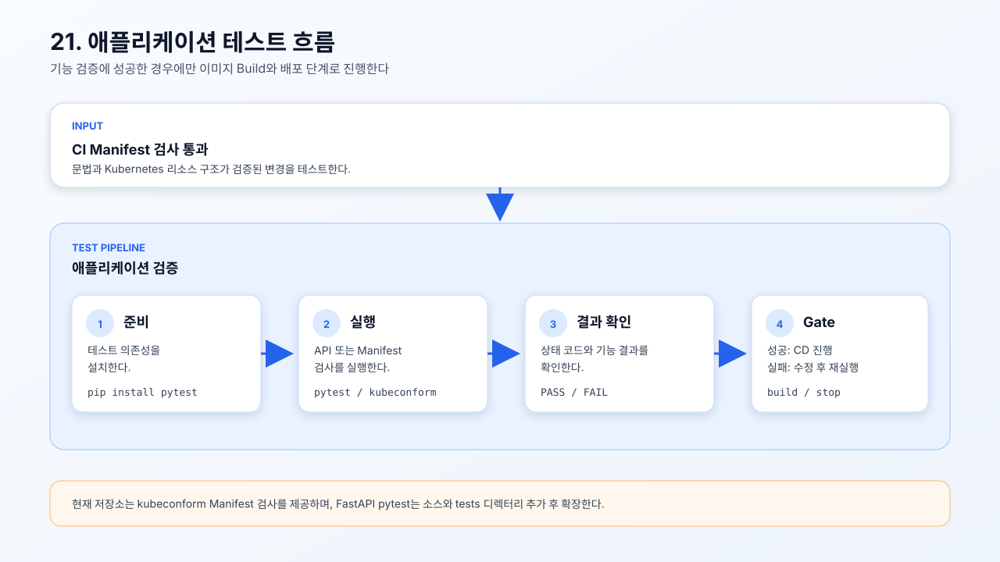

# 21. 애플리케이션 테스트

애플리케이션 테스트는 코드가 문법적으로만 올바른지 확인하는 것이 아니라,
실제 기능이 기대한 결과를 반환하는지 확인하는 단계다.

- [Manifest 검사 스크립트](./check-manifests.sh)
- [애플리케이션 테스트 흐름 SVG](./application-test-overview.svg)



## 애플리케이션 테스트란?

CI가 YAML과 Kubernetes Manifest의 구조를 검사한다면, 애플리케이션 테스트는
FastAPI의 API 응답, 상태 코드, 데이터 처리와 같은 실행 결과를 검사한다.
테스트가 실패하면 이미지 빌드와 배포 단계로 진행하지 않는다.

```text
테스트 의존성 설치
        ↓
테스트 코드 실행
        ↓
API·기능 결과 확인
        ↓
성공: 다음 단계 진행 / 실패: 수정 후 재실행
```

| 구분 | 검사 대상 |
| --- | --- |
| CI Manifest 검사 | YAML 파싱과 Kubernetes 리소스 스키마 |
| 애플리케이션 테스트 | API 응답, 상태 코드와 기능 동작 |
| CD | 검증된 이미지 빌드와 클러스터 배포 |

## 현재 실습 검사

현재 저장소에는 별도의 FastAPI `tests/` 디렉터리가 없으므로, 실행 가능한
기본 검사로 3-Tier Manifest를 `kubeconform`으로 확인한다.

```bash
kubeconform -strict -verbose -output pretty -summary \
  ci-practice/10-3tier/frontend.yml \
  ci-practice/10-3tier/backend.yml \
  ci-practice/11-ingress/ingress.yml
```

이 명령은 `frontend.yml`, `backend.yml`, `11-ingress/ingress.yml`을 직접 검사한다.
Kubernetes API Server에 접속하지 않고도 실행할 수 있다.

## FastAPI 테스트 확장 예시

애플리케이션 소스와 테스트 코드가 준비되면 workflow에 테스트 의존성을 설치한다.

```yaml
- name: Install test dependencies
  run: pip install -r backend/requirements.txt pytest
```

`requirements.txt`와 `pytest`를 설치하여 테스트 실행 환경을 준비한다.

```yaml
- name: Run backend tests
  run: pytest backend/tests
```

`backend/tests`에 작성한 FastAPI 테스트를 실행한다. 실제 저장소의 소스 경로와
테스트 경로에 맞게 명령어를 조정한다.

## CI·CD와의 연결

19번 CI에서 Manifest 검사를 통과한 뒤 애플리케이션 테스트를 실행하고, 테스트가
성공한 경우에만 20번 CD의 이미지 Build와 배포 단계로 진행한다.
