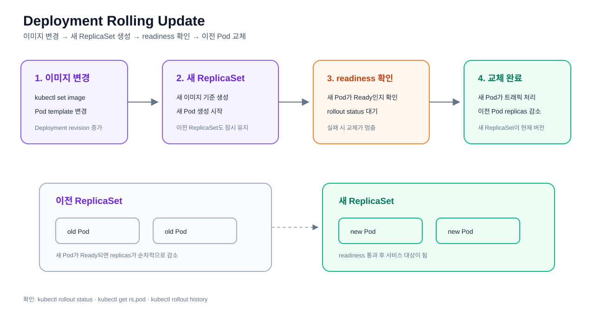

# 24. Kubernetes Rolling Update 실습

Deployment의 컨테이너 이미지를 변경하고, 새 ReplicaSet과 Pod가 준비되는
Rolling Update 과정을 확인한다.



## 학습 목표

- Deployment의 Pod template 변경이 새 ReplicaSet을 만드는 과정 확인
- readiness 조건을 통과한 새 Pod로 교체되는 과정 확인
- 이전 Pod와 새 Pod의 상태 비교
- rollout 완료 여부와 revision 확인

## 사전 조건

`fastcgi-backend` Deployment가 실행 중이어야 한다. 기본 3-Tier 예제를 먼저
적용하거나 배포 스크립트를 사용한다.

```bash
kubectl apply -f ../10-3tier/frontend.yml
```

Frontend Deployment와 Service를 준비한다.

```bash
kubectl apply -f ../10-3tier/backend.yml
```

Backend Deployment와 Service를 준비한다.

```bash
kubectl get deployment,pod,rs -l app=fastcgi-backend
```

Rolling Update 전 Deployment, Pod, ReplicaSet 상태를 확인한다.

## Rolling Update 실행

이미지 태그를 변경하면 Deployment의 Pod template이 바뀌고 새 ReplicaSet이
생성된다. 실제로 존재하는 이미지 태그를 사용한다.

```bash
export NAMESPACE=default
export IMAGE_TAG=latest
```

대상 Namespace와 변경할 이미지 태그를 지정한다.

```bash
kubectl -n "$NAMESPACE" set image deployment/fastcgi-backend \
  backend=jarrodkim/fastapi-backend:"$IMAGE_TAG"
```

Deployment의 Backend 컨테이너 이미지를 변경해 새 ReplicaSet 생성을 시작한다.

```bash
kubectl rollout status deployment/fastcgi-backend --timeout=180s
```

새 ReplicaSet과 Pod가 준비되어 Rolling Update가 완료될 때까지 기다린다.

```bash
kubectl -n "$NAMESPACE" get deployment,rs,pod -l app=fastcgi-backend -o wide
```

`rollout status`가 완료될 때까지 새 Pod의 readiness probe가 통과하는지 확인한다.
새 ReplicaSet이 생성되고 이전 ReplicaSet의 replicas가 줄어드는 과정을 관찰한다.

```bash
kubectl -n "$NAMESPACE" rollout history deployment/fastcgi-backend
```

Deployment revision 이력을 확인한다.

```bash
kubectl -n "$NAMESPACE" describe deployment fastcgi-backend
```

현재 Deployment의 selector, ReplicaSet, 이벤트를 상세 확인한다.

```bash
kubectl -n "$NAMESPACE" get events --sort-by=.lastTimestamp | tail -20
```

최근 Rolling Update 관련 이벤트를 확인한다.

## 배포 스크립트

격리된 테스트 네임스페이스를 사용할 때는 `NAMESPACE` 환경변수로 대상을
지정한다. 생략하면 `default`를 사용한다.

```bash
NAMESPACE=ci-verify bash ./practice-order/24-rollout/deploy.sh IMAGE:TAG
```

- [배포 스크립트](./deploy.sh)

배포가 완료되기 전에는 이전 ReplicaSet의 Pod가 계속 실행될 수 있다. 서비스
중단 여부와 readiness 상태를 함께 확인한다.

```bash
kubectl -n "$NAMESPACE" get pods -l app=fastcgi-backend \
  -o custom-columns=NAME:.metadata.name,IMAGE:.spec.containers[0].image,READY:.status.containerStatuses[0].ready
```

각 Pod의 이미지와 Ready 상태를 확인한다.

```bash
kubectl -n "$NAMESPACE" logs deployment/fastcgi-backend --tail=50
```

Rolling Update 이후 Backend 애플리케이션 로그를 확인한다.

이 실습에서는 정상 Rolling Update만 다룬다. 잘못된 이미지로 인한 롤백은
[`25-rollback-approval`](../25-rollback-approval/README.md)에서 진행한다.
