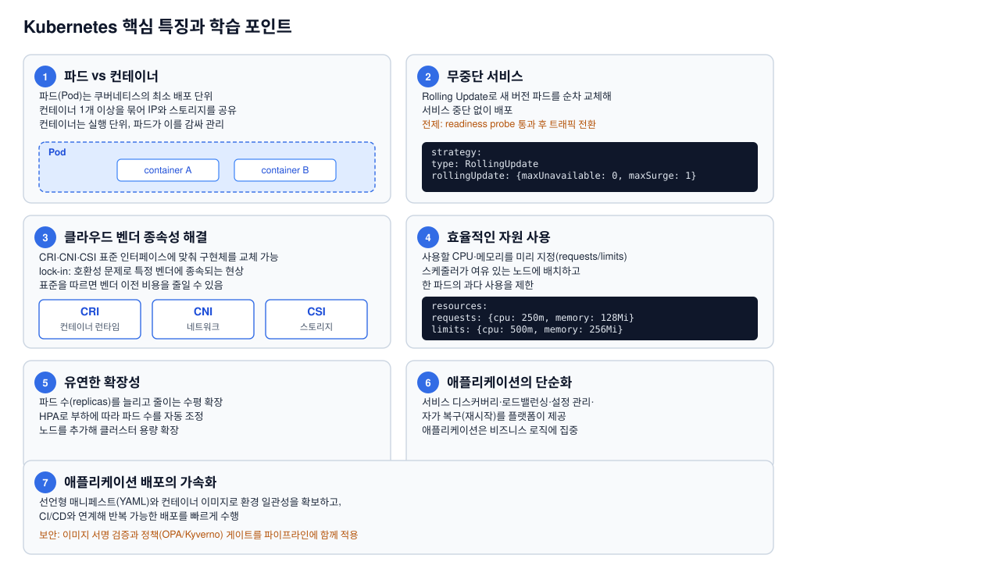

# Kubernetes 기본 구조

이 디렉터리는 실습이나 운영 명령을 실행하기 전에 Kubernetes의 기본 구성과
리소스 사이의 관계를 설명한다.

## SVG 작성 기준

모든 구조 설명 SVG는 PowerPoint 와이드 화면에 맞춘 다음 규격을 사용한다.

- 화면 비율: `16:9`
- SVG viewBox: `0 0 1280 720`
- 문서 크기: `13.333in × 7.5in`
- 제목과 본문은 겹치지 않도록 여백을 확보한다.
- 한 SVG에는 하나의 설명 목적만 두고, 세 SVG 사이의 내용을 중복하지 않는다.

기본 구조는 한 장의 그림에 모든 내용을 넣지 않고, 다음 세 관점으로 나누어
확인한다.

1. [전체 구성](./kubernetes-basic-structure.svg): 클러스터와 저장소 영역의 큰 관계
2. [클러스터 내부 구성](./kubernetes-architecture.svg): Control Plane과 Worker Node의 동작
3. [핵심 특징](./kubernetes-features.svg): 리소스·배포·확장 관점의 학습 포인트

## 1. 전체 구성


클러스터 전체와 `install/`, `structure/`, `practice-order/`, `operations/`,
`examples/`의 역할을 먼저 확인한다.

## 2. 클러스터 내부 구성


Control Plane이 상태를 조정하고 Worker Node의 kubelet과 컨테이너 런타임이
Pod를 실행한다. 이 흐름은 리소스가 실제 실행으로 이어지는 과정을 설명한다.

## 3. 핵심 특징



Pod, Rolling Update, 표준 인터페이스, 자원 관리, 확장성과 선언형 배포를
실습에서 왜 사용하는지 연결해서 설명한다.

## 기본 구성

```text
k8s/
├── install/          # 클러스터를 설치하고 Addon을 구성
├── structure/        # Kubernetes 기본 구성과 리소스 관계 설명
├── practice-order/   # 학습 순서에 따른 선언 리소스 실습
├── operations/       # 설치된 클러스터의 상태 확인과 장애 대응
└── examples/         # 실습 파일 생성을 위한 내부 원본 예제
```

## Kubernetes 내부 관계

```text
Cluster
├── Control Plane
│   ├── API Server       # 모든 리소스 요청의 진입점
│   ├── Scheduler        # Pod를 실행할 Node 선택
│   ├── Controller       # 원하는 상태와 실제 상태 조정
│   └── etcd             # 클러스터 상태 저장
└── Worker Node
    ├── kubelet          # Node에서 Pod 실행 상태 관리
    ├── container runtime
    └── Pod
        ├── Container
        ├── ConfigMap / Secret
        ├── Service       # Pod 접근 경로 제공
        └── PV / PVC      # 영속 데이터 연결
```

## 저장소 디렉터리와의 관계

| 영역 | 역할 | 다음 단계 |
| --- | --- | --- |
| `install/` | Kubernetes와 필수 Addon 설치 | 설치된 클러스터 준비 |
| `structure/` | 구성요소와 리소스 관계 이해 | 실습 대상 파악 |
| `practice-order/` | YAML을 이용한 리소스 생성·검증 | 선언 상태 구성 |
| `operations/` | 실제 클러스터 상태 확인·문제 해결 | 운영 상태 관리 |
| `examples/` | 실습 파일의 내부 기반 자료 | 학습자 실습 대상 아님 |

`install/`은 클러스터를 준비하고, `structure/`는 구성 원리를 설명한다.
`practice-order/`는 리소스를 선언하여 상태를 만들며, `operations/`는 만들어진
상태가 정상인지 확인한다.

## 주요 관계

- `Deployment` 또는 `StatefulSet`은 Pod의 원하는 상태를 관리한다.
- `Service`는 변경되는 Pod를 고정된 접근 이름과 포트로 연결한다.
- `ConfigMap`과 `Secret`은 설정과 민감 정보를 Pod에 전달한다.
- `PVC`는 Pod가 저장소를 요청하고 PV와 연결되도록 한다.
- Controller는 리소스의 원하는 상태와 실제 상태 차이를 줄인다.
- Addon은 CNI, Ingress Controller, CSI, Metrics Server처럼 클러스터 기능을
  확장한다.

자세한 설치 절차는 [설치 계획](../install/plan.md), 실습 순서는
[practice-order](../practice-order/README.md), 운영 점검은
[operations](../operations/README.md)에서 확인한다.
